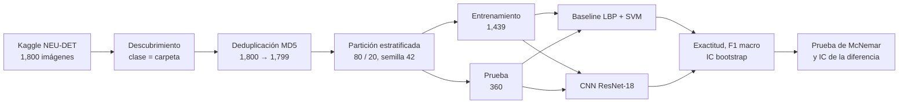
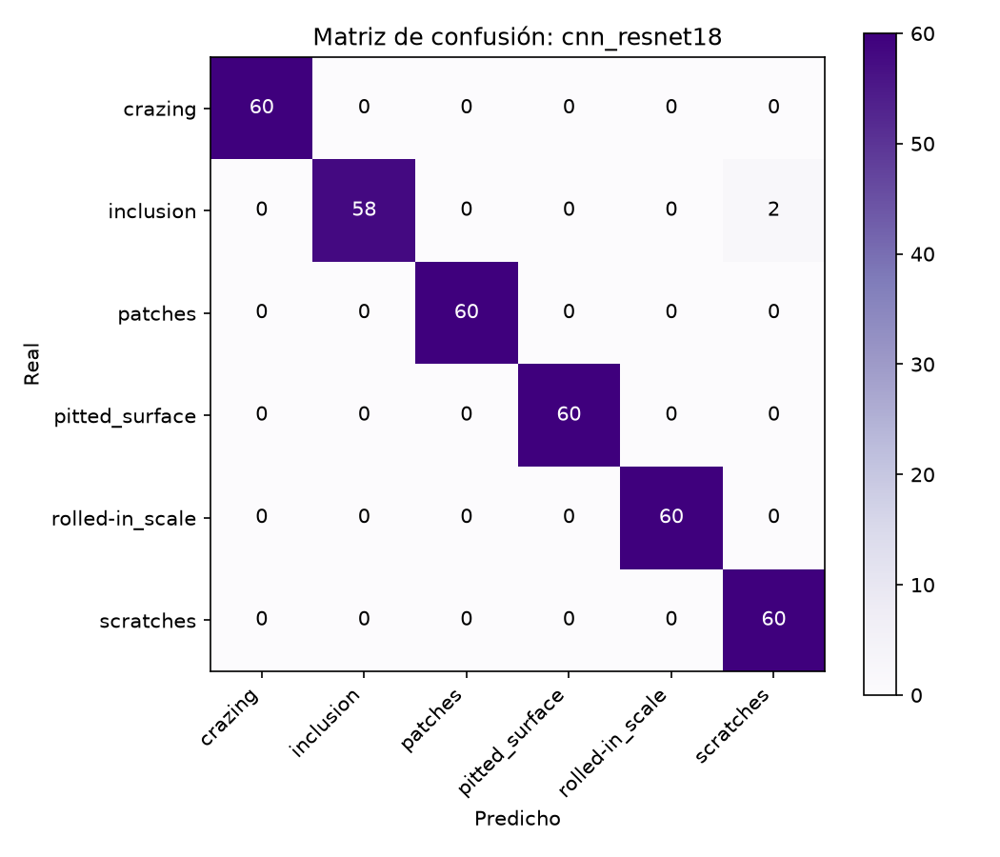

# Detección de defectos superficiales en acero (dataset NEU)

Clasificación de seis tipos de defecto superficial en láminas de acero laminado. Se comparan un **baseline clásico de Procesamiento Digital de Imágenes (PDI)** con descriptores de textura LBP y un SVM, contra una **red neuronal convolucional (CNN)** ResNet-18 con transfer learning. La comparación se evalúa con intervalos de confianza y con una prueba estadística pareada.

**Resumen de hallazgos**

- Ambos modelos superan el 98 % de exactitud en el conjunto de prueba.
- La CNN obtuvo una exactitud 0.83 puntos porcentuales mayor, pero la diferencia **no es estadísticamente significativa** (McNemar, p = 0.453).
- El baseline clásico es competitivo con la CNN en esta tarea, con un costo computacional mucho menor.

## 1. Problemática

En la industria siderúrgica, los defectos superficiales (grietas, inclusiones, manchas, picaduras, escamas y rayas) reducen la calidad del producto, generan retrabajo y pueden provocar reclamaciones de clientes. La inspección manual es lenta, subjetiva y difícil de sostener en líneas de alta velocidad. Un sistema automático que identifique el tipo de defecto permite corregir el proceso productivo y no solo descartar piezas.

## 2. Dataset

- **Nombre:** NEU Surface Defect Database, publicado en Kaggle por `kaustubhdikshit`.
- **Clases (K = 6):** `crazing`, `inclusion`, `patches`, `pitted_surface`, `rolled-in_scale`, `scratches`.
- **Imágenes:** 1,800 en escala de grises, 300 por clase.
- **Organización:** `NEU-DET/{train,validation}/images/<clase>/`. La carpeta `annotations/` contiene XML de bounding boxes, que este proyecto no usa.

El dataset es originalmente de **detección de objetos**. Aquí se reutiliza para **clasificación**, tomando la clase desde el nombre de la carpeta.

| Subconjunto | Imágenes | Uso |
|---|---|---|
| Original | 1,800 | Punto de partida |
| Tras deduplicación | 1,799 | Una copia exacta eliminada (`patches_105.jpg`) |
| Entrenamiento | 1,439 | Ajuste de pesos y búsqueda de hiperparámetros |
| Prueba | 360 | Evaluación final, sin intervenir en decisiones |

En la CNN, el 10 % del entrenamiento (144 imágenes) se separa como validación interna para *early stopping*.

## 3. Notación

| Símbolo | Significado |
|---|---|
| $n$ | Número de imágenes de prueba ($n = 360$) |
| $y_i$, $\hat{y}_i$ | Clase real y clase predicha de la imagen $i$ |
| $K$ | Número de clases ($K = 6$) |
| $\mathbf{1}[\cdot]$ | Función indicadora: vale 1 si la condición se cumple, 0 si no |
| $\mathrm{TP}_c, \mathrm{FP}_c, \mathrm{FN}_c$ | Verdaderos positivos, falsos positivos y falsos negativos de la clase $c$ |
| $\alpha$ | Nivel de significancia ($\alpha = 0.05$) |
| $B$ | Número de remuestreos bootstrap ($B = 2000$) |
| $n_{01}, n_{10}$ | Casos discordantes entre dos modelos (ver sección 6) |
| $\eta_t$ | Tasa de aprendizaje en la época $t$ |

## 4. Pipeline



Pasos:

1. **Descarga:** `src/download.py` obtiene el dataset con `kagglehub` y lo guarda en la caché local, fuera del repositorio.
2. **Descubrimiento:** `discover_samples` asigna a cada imagen su clase y verifica que existan las seis.
3. **Deduplicación:** `deduplicate` compara huellas MD5 y conserva una copia por contenido.
4. **Particionado:** `stratified_split` separa 80 % y 20 %, manteniendo la proporción de clases, con semilla fija.
5. **Verificación de fuga:** `check_leakage` confirma que ninguna huella de prueba aparece en entrenamiento. Si aparece, la ejecución se detiene.
6. **Modelos:** el baseline y la CNN se entrenan solo con el conjunto de entrenamiento.
7. **Evaluación:** cada modelo se evalúa una vez sobre el conjunto de prueba, con métricas, IC bootstrap y predicciones guardadas por imagen.
8. **Comparación:** `compare_models.py` aplica la prueba de McNemar y el IC de la diferencia sobre las mismas 360 imágenes.

## 5. Fundamentos técnicos

### 5.1 Baseline: LBP + SVM

**LBP (Local Binary Patterns).** Para cada píxel central $g_c$ con $P$ vecinos $g_p$ a radio $R$:

$$
\mathrm{LBP}_{P,R} = \sum_{p=0}^{P-1} s(g_p - g_c)\, 2^p, \qquad s(x) = \begin{cases} 1 & x \ge 0 \\ 0 & x < 0 \end{cases}
$$

Se usan patrones *uniformes* (como máximo dos transiciones 0/1 circulares), lo que da $P + 2$ valores posibles. El descriptor es el histograma de estos códigos. Se calcula a tres escalas, $(P, R) \in \{(8,1), (16,2), (24,3)\}$, y los histogramas se concatenan.

**SVM con kernel RBF.** El clasificador usa la función de decisión

$$
f(\mathbf{x}) = \text{sign}\!\left(\sum_{i} \alpha_i y_i K(\mathbf{x}_i, \mathbf{x}) + b\right), \qquad K(\mathbf{x}, \mathbf{x}') = \exp\!\left(-\gamma \lVert \mathbf{x} - \mathbf{x}' \rVert^2\right)
$$

Para $K > 2$ clases se usa la estrategia uno contra uno. Los parámetros $C$ y $\gamma$ se eligen por validación cruzada de 5 particiones sobre el entrenamiento, optimizando F1 macro.

### 5.2 CNN: ResNet-18 con transfer learning

La red parte de pesos preentrenados en ImageNet. Se reemplaza la capa final por una capa lineal de 6 salidas y se ajustan todos los pesos (*fine-tuning*).

**Función de pérdida** (entropía cruzada), donde $p_{i,c}$ es la probabilidad que la red asigna a la clase $c$ para la imagen $i$:

$$
\mathcal{L} = -\frac{1}{N} \sum_{i=1}^{N} \log p_{i, y_i}
$$

**Programación de la tasa de aprendizaje** (coseno, con $T$ épocas):

$$
\eta_t = \frac{\eta_{\max}}{2}\left(1 + \cos\frac{\pi t}{T}\right)
$$

**Early stopping.** Se detiene el entrenamiento si la exactitud de validación no mejora durante 4 épocas consecutivas, y se restauran los pesos de la mejor época.

### 5.3 Métricas

$$
\mathrm{Acc} = \frac{1}{n} \sum_{i=1}^{n} \mathbf{1}[y_i = \hat{y}_i]
$$

Por clase:

$$
P_c = \frac{\mathrm{TP}_c}{\mathrm{TP}_c + \mathrm{FP}_c}, \qquad R_c = \frac{\mathrm{TP}_c}{\mathrm{TP}_c + \mathrm{FN}_c}, \qquad F1_c = \frac{2 P_c R_c}{P_c + R_c}
$$

F1 macro, con el mismo peso por clase:

$$
\mathrm{F1}_{\text{macro}} = \frac{1}{K} \sum_{c=1}^{K} F1_c
$$

Como cada clase tiene aproximadamente 60 imágenes en prueba, la exactitud y el F1 macro son casi iguales. Esto es consistente con un conjunto balanceado.

## 6. Pruebas estadísticas

Un resultado como "98.6 %" es una estimación puntual. Con 360 imágenes, cambiar 3 predicciones mueve la exactitud casi un punto. Por eso se reportan intervalos y una prueba pareada.

### 6.1 Intervalo de confianza por bootstrap

Se remuestrean las $n$ imágenes de prueba con reemplazo, $B$ veces, y se calcula la métrica $\theta^*_b$ en cada remuestreo. El intervalo percentil al $(1 - \alpha)$ es

$$
\text{IC}_{95} = \left[\theta^*_{(\alpha/2)},\ \theta^*_{(1-\alpha/2)}\right]
$$

donde $\theta^*_{(q)}$ es el percentil $q$ de la distribución bootstrap. Con $B = 2000$ y $\alpha = 0.05$.

### 6.2 Comparación pareada: prueba de McNemar

Ambos modelos se evalúan sobre las mismas imágenes, así que sus errores están emparejados. Se definen:

- $n_{01}$: casos en los que el baseline acierta y la CNN falla.
- $n_{10}$: casos en los que el baseline falla y la CNN acierta.

Bajo la hipótesis nula $H_0$ (ambos modelos tienen la misma tasa de error), cada caso discordante tiene probabilidad $0.5$ de favorecer a cualquiera de los dos. La prueba exacta es

$$
p = \min\!\left(1,\ 2 \sum_{k=0}^{\min(n_{01}, n_{10})} \binom{n_{01} + n_{10}}{k} \left(\tfrac{1}{2}\right)^{n_{01} + n_{10}}\right)
$$

Si $p < \alpha$, se rechaza $H_0$ y la diferencia es significativa.

### 6.3 Intervalo de la diferencia de exactitud

Para medir cuánto mejora un modelo sobre otro, se calcula la diferencia pareada

$$
\Delta = \mathrm{Acc}_{\text{CNN}} - \mathrm{Acc}_{\text{baseline}}
$$

y su intervalo bootstrap, remuestreando los mismos índices para ambos modelos. Si el intervalo contiene 0, la diferencia no es concluyente.

## 7. Verificación de fuga de datos

La fuga ocurre cuando información de prueba llega al entrenamiento. Por ejemplo, si la misma imagen aparece en ambos lados, el modelo "reconoce" la respuesta y las métricas quedan infladas.

Se aplican dos controles:

1. **Deduplicación previa al particionado:** se eliminó 1 copia exacta (`patches_101.jpg` y `patches_105.jpg`). Se identificó por hash MD5.
2. **Verificación posterior:** `check_leakage` recalcula el hash de cada imagen de prueba y confirma que ninguno aparece en entrenamiento. El resultado en ambas ejecuciones fue **0 coincidencias**.

Las pruebas de McNemar y los IC bootstrap dan la magnitud de la incertidumbre. La verificación de fuga garantiza que esa incertidumbre no esté inflada por duplicados.

## 8. Estructura del proyecto

```
04-defectos-neu/
├── README.md
├── requirements.txt
├── run_experiment.py        # punto de entrada: baseline o CNN
├── compare_models.py        # McNemar e IC de la diferencia
├── src/
│   ├── data.py              # descubrimiento, deduplicación, particionado, fuga
│   ├── stats.py             # bootstrap, McNemar, diferencia pareada
│   ├── metrics.py           # métricas, IC y matriz de confusión
│   ├── baseline.py          # LBP + SVM
│   ├── cnn.py               # ResNet-18 con fine-tuning
│   └── download.py          # descarga desde Kaggle
└── resultados/              # métricas, predicciones, comparación (pesos .pt excluidos)
```

## 9. Ejecución

Desde `04-defectos-neu`, con el entorno virtual activo:

```bash
pip install -r requirements.txt
python src/download.py
python run_experiment.py --data-dir "<ruta_impresa_por_download>" --model baseline
python run_experiment.py --data-dir "<ruta_impresa_por_download>" --model cnn --epochs 8 --img-size 128
python compare_models.py --res-dir resultados --a baseline_lbp_svm --b cnn_resnet18
```

## 10. Resultados

### 10.1 Configuración

- Partición: 80/20 estratificada, semilla 42. Entrenamiento 1,439; prueba 360.
- Baseline: LBP multiescala + SVM RBF. Mejores hiperparámetros elegidos por validación cruzada.
- CNN: ResNet-18, 8 épocas, 128 px, AdamW con $\eta_{\max} = 3 \times 10^{-4}$ y programación coseno.

### 10.2 Métricas en el conjunto de prueba

| Modelo | Exactitud | IC 95 % (exactitud) | F1 macro | IC 95 % (F1 macro) | Aciertos |
|---|---|---|---|---|---|
| Baseline LBP + SVM | 0.9861 | [0.9722, 0.9972] | 0.9861 | [0.9720, 0.9970] | 355 / 360 |
| CNN ResNet-18 | 0.9944 | [0.9861, 1.0000] | 0.9944 | [0.9854, 1.0000] | 358 / 360 |

Los intervalos se traslapan, pero la CNN tiene un intervalo más alto y más estrecho en el límite inferior.

### 10.3 Comparación pareada

| Concepto | Valor |
|---|---|
| Baseline acierta y CNN falla ($n_{01}$) | 2 |
| Baseline falla y CNN acierta ($n_{10}$) | 5 |
| Casos discordantes totales | 7 |
| Valor p (McNemar exacto) | 0.453 |
| $\Delta = \mathrm{Acc}_{\text{CNN}} - \mathrm{Acc}_{\text{baseline}}$ | +0.0083 (+0.83 puntos) |
| IC 95 % de $\Delta$ (bootstrap, $B = 2000$) | [−0.0056, +0.0222] |

**Lectura:** el valor p es mayor que 0.05 y el IC de $\Delta$ incluye 0. No hay evidencia estadística de que la CNN sea mejor que el baseline en este conjunto de prueba. Solo 7 de 360 casos cambian de resultado entre modelos, lo que da poca potencia para detectar diferencias pequeñas.

Ausencia de significancia no significa equivalencia demostrada. Lo que sí se puede afirmar es que la ventaja aparente de la CNN (3 imágenes) está dentro del margen de variación de esta prueba.

### 10.4 Entrenamiento de la CNN

| Época | Train loss | Train acc | Val loss | Val acc |
|---|---|---|---|---|
| 01 | 0.2891 | 0.894 | 0.0353 | 0.979 |
| 02 | 0.1314 | 0.954 | 0.0506 | 0.979 |
| 03 | 0.1288 | 0.956 | 0.0427 | 0.979 |
| 04 | 0.0713 | 0.978 | 0.0556 | 0.986 |
| 05 | 0.0344 | 0.988 | 0.0171 | 0.993 |
| 06 | 0.0252 | 0.995 | 0.0015 | 1.000 |
| 07 | 0.0214 | 0.992 | 0.0013 | 1.000 |
| 08 | 0.0071 | 0.999 | 0.0013 | 1.000 |

La validación alcanzó 1.000 en la época 6, así que los pesos guardados corresponden a esa época. El early stopping no se activó porque la exactitud de validación nunca dejó de ser máxima. Por lo tanto, el conjunto de validación de 144 imágenes resultó fácil y no discrimina entre épocas posteriores.

### 10.5 Matrices de confusión

Baseline LBP + SVM:


CNN ResNet-18:



El detalle por clase (precisión, recall y F1) está en `resultados/metrics_baseline_lbp_svm.json` y `resultados/metrics_cnn_resnet18.json`. Las predicciones por imagen están en `resultados/predictions_*.csv`.

## 11. Importancia de los resultados

- **Para la inspección industrial:** ambos enfoques distinguen los seis defectos con error menor al 2 %. Eso permite automatizar la clasificación en la línea.
- **Para la decisión de diseño:** el baseline clásico logra un desempeño equivalente con un modelo mucho más ligero, explicable y barato de operar. La CNN solo se justificaría si mejora de forma significativa en un conjunto de prueba más grande o más difícil.
- **Sobre las rayas:** la CNN clasificó correctamente las 60 imágenes de *scratches* en prueba, mientras el baseline falló en 3. Es la fuente de casi toda la diferencia, pero es un patrón en una clase, no una superioridad general demostrada.
- **Para la metodología:** la diferencia entre modelos es de 3 imágenes. Reportar solo la cifra puntual habría sugerido una ventaja que las pruebas no respaldan.

## 12. Observaciones metodológicas y técnicas

- **Prevención de fuga de datos:** deduplicación previa y verificación automática. Ambas se ejecutan en cada corrida.
- **Conjunto de prueba aislado:** no interviene en la búsqueda de hiperparámetros, en la selección de épocas ni en el early stopping.
- **Pruebas estadísticas obligatorias:** todo resultado experimental se reporta con IC. La comparación entre modelos se hace con McNemar sobre casos pareados, no comparando cifras puntuales.
- **Reproducibilidad:** partición estratificada con semilla fija, predicciones por imagen guardadas y comandos documentados.
- **Consistencia en la evaluación:** las etiquetas textuales (baseline) y los índices (CNN) pasan por la misma conversión antes de calcular métricas.
- **Reutilización del dataset de detección:** la clase se toma de la carpeta y las bounding boxes no se usan. Es válido para clasificación, pero debe documentarse.

## 13. Costo computacional y consideraciones de despliegue

| Aspecto | Baseline LBP + SVM | CNN ResNet-18 |
|---|---|---|
| Representación de entrada | Vector de 54 dimensiones (10 + 18 + 26 bins de los tres histogramas LBP) | Imagen completa en 128 px (prueba) o 224 px (corrida final) |
| Parámetros del modelo | Vectores de soporte del SVM (cantidad pendiente de medir) | Aprox. 11.7 millones |
| Tamaño en disco | Pendiente de medir | 44.7 MB (archivo de pesos de PyTorch) |
| Memoria de inferencia | Mínima: vector de características y SVM | Mayor: activaciones intermedias de la red |
| Memoria de entrenamiento | Pequeña | Alta: gradientes y estados de AdamW (dos por parámetro) |

**Lectura para despliegue industrial.** Ambos modelos alcanzan exactitudes equivalentes en este conjunto de prueba. El baseline requiere mucho menos memoria y cómputo, lo que facilita ejecutarlo en controladores o equipos de borde. La CNN necesita GPU o un acelerador para mantener una tasa de inspección alta.

**Pendiente.** Medir en el mismo equipo la latencia por imagen y la memoria pico de inferencia de ambos modelos, así como el tamaño serializado del SVM. Sin estas cifras, la comparación de costo es cualitativa.

## 14. Limitaciones

- **Una sola partición de prueba:** los IC cuantifican la variabilidad del muestreo de las 360 imágenes, no la variabilidad del entrenamiento. Con una sola semilla no se mide la variación entre corridas.
- **Poca potencia estadística:** con 7 casos discordantes, la prueba de McNemar solo detecta diferencias grandes. Una diferencia pequeña podría existir sin ser detectada.
- **CNN en configuración reducida:** 8 épocas y 128 px por limitaciones de tiempo en CPU. Una configuración mayor podría cambiar la comparación.
- **Validación fácil:** la validación interna llega a 1.000 de exactitud, por lo que no discrimina bien entre configuraciones.
- **Dominio controlado:** las imágenes son de laboratorio, con iluminación y encuadre uniformes. El desempeño en líneas reales puede ser menor.
- **Baseline con histograma global:** el descriptor LBP pierde la posición espacial del defecto.
- **Costo no medido:** latencia y memoria de inferencia aún no se han medido en el equipo de despliegue.
- **Clasificación, no localización:** el sistema indica qué defecto hay, pero no dónde.

## 15. Insights centrales

- Los descriptores de textura bien elegidos son una referencia muy fuerte para inspección superficial en entornos controlados.
- Un modelo de aprendizaje profundo debe compararse contra un baseline clásico bien ajustado y con una prueba pareada, no contra cifras puntuales.
- La calidad del pipeline de datos (deduplicación, particionado, aislamiento de la prueba, verificación de fuga) afecta la validez de los resultados tanto como el modelo.
- Con conjuntos de prueba pequeños, una diferencia de un par de imágenes no es evidencia de superioridad.

## 16. Aplicaciones futuras

- **Localización de defectos:** entrenar un detector de objetos con las bounding boxes del dataset original.
- **Validación en producción:** probar con imágenes de líneas reales y aplicar adaptación de dominio.
- **Evaluación más robusta:** validación cruzada repetida y varias semillas, con IC sobre la variabilidad de entrenamiento.
- **Inspección en tiempo real:** integrar con cámaras industriales y medir latencia.
- **Retroalimentación de proceso:** analizar tendencias de defectos para ajustar la laminación.

## 17. Glosario

- **PDI (Procesamiento Digital de Imágenes):** técnicas para transformar y analizar imágenes con algoritmos explícitos.
- **LBP (Local Binary Patterns):** descriptor de textura basado en comparaciones entre un píxel y sus vecinos.
- **SVM (Support Vector Machine):** clasificador que maximiza el margen entre clases.
- **Kernel RBF:** función que permite fronteras de decisión no lineales.
- **CNN:** red que aprende filtros para extraer características espaciales.
- **ResNet-18:** arquitectura convolucional con conexiones residuales y 18 capas con pesos.
- **Transfer learning:** reutilizar un modelo preentrenado para una tarea nueva.
- **Fine-tuning:** ajustar los pesos de un modelo preentrenado con datos del nuevo dominio.
- **Aumentación de datos:** generar variantes de las imágenes (rotaciones, volteos, cambios de brillo).
- **Entropía cruzada:** función de pérdida que penaliza la probabilidad baja asignada a la clase correcta.
- **Early stopping:** detener el entrenamiento cuando la validación deja de mejorar.
- **Validación cruzada:** evaluar dividiendo los datos de entrenamiento en particiones rotativas.
- **Particionado estratificado:** dividir manteniendo la proporción de clases.
- **Fuga de datos (data leakage):** información de prueba que llega al entrenamiento y sobreestima el desempeño.
- **Hash MD5:** huella digital de un archivo, usada para detectar copias idénticas.
- **Exactitud (accuracy):** proporción de predicciones correctas.
- **Precisión:** de las predicciones de una clase, proporción correcta.
- **Recall (sensibilidad):** de los casos reales de una clase, proporción detectada.
- **F1:** media armónica entre precisión y recall.
- **F1 macro:** promedio del F1 por clase, con el mismo peso.
- **Matriz de confusión:** tabla que cruza clase real y clase predicha.
- **Intervalo de confianza (IC):** rango que, con un nivel dado (95 %), contiene el valor verdadero con esa frecuencia en repeticiones del muestreo.
- **Bootstrap:** método de remuestreo con reemplazo para estimar la variabilidad de una métrica.
- **Hipótesis nula ($H_0$):** supuesto de que no hay diferencia entre los modelos.
- **Valor p:** probabilidad de observar un resultado tan extremo como el obtenido si $H_0$ fuera verdadera.
- **Prueba de McNemar:** prueba pareada que compara dos clasificadores usando los casos en que discrepan.
- **Casos discordantes:** imágenes en las que dos modelos aciertan y fallan de forma distinta.
- **Potencia estadística:** probabilidad de detectar una diferencia real cuando existe.
- **Sobreajuste (overfitting):** el modelo memoriza el entrenamiento y generaliza mal.

## 18. Estado del proyecto

- [x] Descarga y verificación del dataset.
- [x] Deduplicación, particionado estratificado y verificación de fuga.
- [x] Baseline LBP + SVM con IC bootstrap.
- [x] CNN ResNet-18 con transfer learning (8 épocas, 128 px).
- [x] Prueba de McNemar e IC de la diferencia.
- [ ] Corrida final de la CNN con configuración mayor (15 épocas, 224 px).
- [ ] Medición de latencia, memoria pico y tamaño del SVM.
- [ ] Análisis de errores por clase.
- [ ] Varias semillas para medir la variabilidad de entrenamiento.

## 19. Uso de inteligencia artificial

Se empleó ayuda de inteligencia artificial (Claude) para la redacción del código y de este documento. Las ejecuciones, métricas y pruebas estadísticas provienen de corridas reales en el equipo local del autor.
