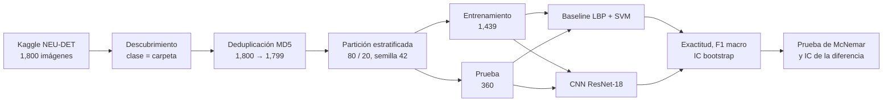
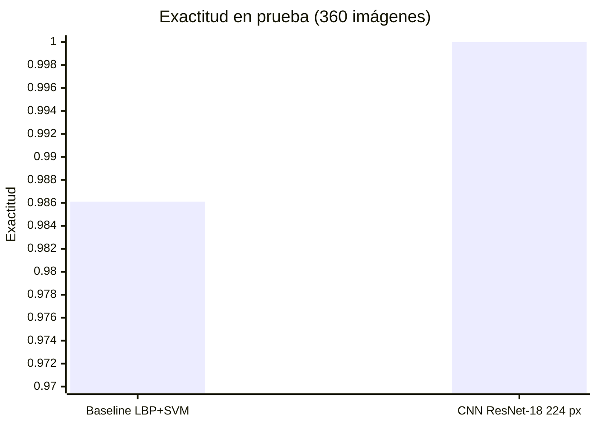
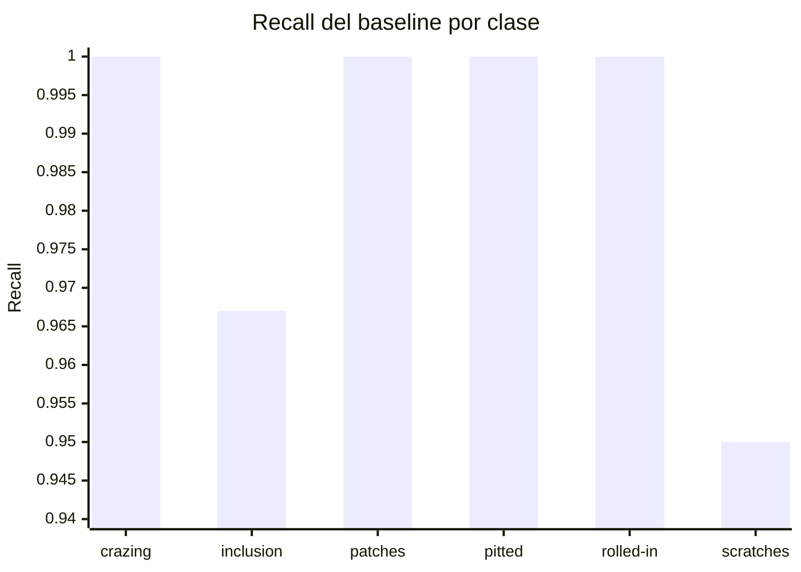
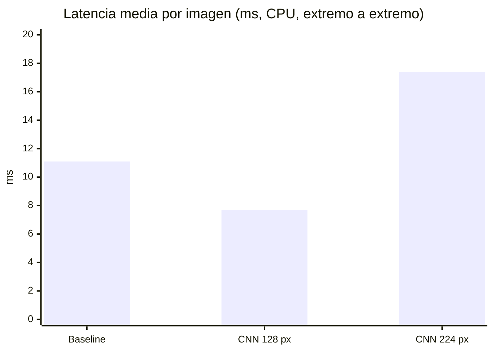
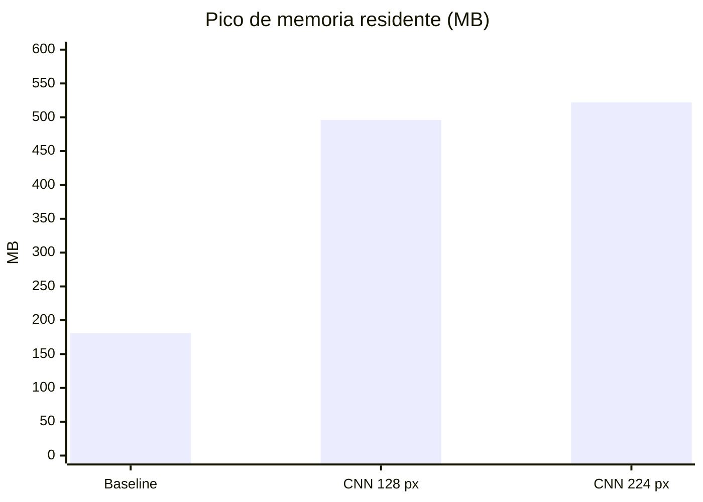
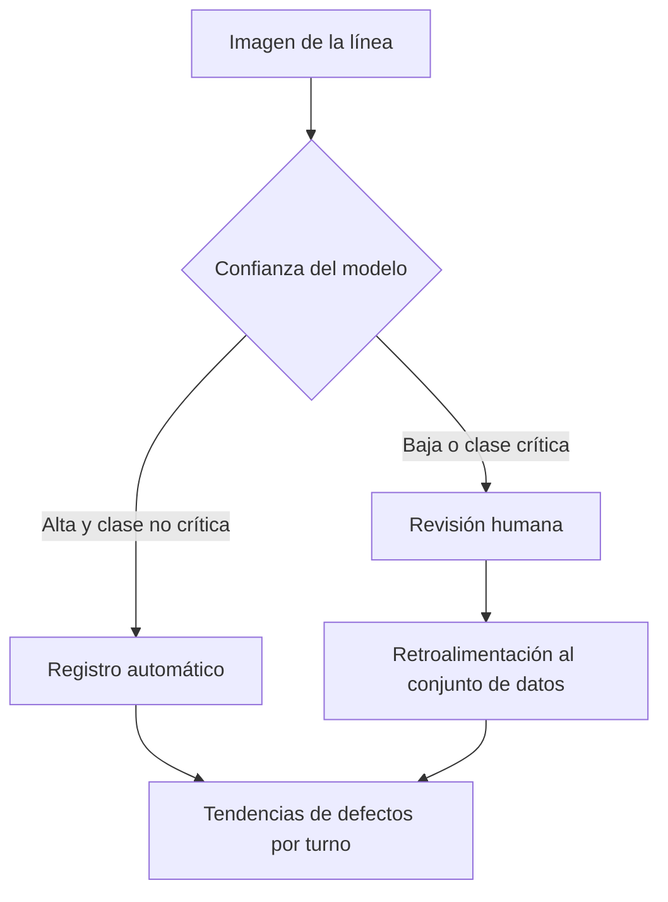

# Sistema de visión para la detección de fallas en placas metálicas: estudio de laboratorio con el dataset NEU

> **Alcance de este documento.** Es un estudio de laboratorio en un entorno controlado, con un dataset público de imágenes. **No tiene validez para una aplicación industrial real en una siderúrgica.** Los resultados no son reproducibles directamente en una línea de producción, ni son comparables con las estadísticas de una planta con mayor volumen de placas metálicas. Cualquier despliegue requiere validación en planta con datos propios, como se detalla en la sección 12.5.

Clasificación de seis tipos de defecto superficial en láminas de acero laminado. Se comparan un **baseline clásico de Procesamiento Digital de Imágenes (PDI)** con descriptores de textura LBP y un SVM, contra una **red neuronal convolucional (CNN)** ResNet-18 con transfer learning. Todas las cifras provienen de corridas reales en un equipo local, con intervalos de confianza y pruebas estadísticas pareadas. El objetivo es comparar metodologías en condiciones controladas, no certificar un sistema para producción.

## Alcance y validez

| Aspecto | Este estudio | Lo que requiere una aplicación industrial |
|---|---|---|
| Condiciones de captura | Imágenes de laboratorio, iluminación y encuadre uniformes | Cámaras en línea, con polvo, vibración, reflejos y cambios de luz por turno |
| Velocidad de la línea | No se modela | Tasa de inspección sostenida a la velocidad real de laminación |
| Tipos de placa y acero | Una colección de 1,800 imágenes de 6 clases | Múltiples aleaciones, espesores, acabados y lotes |
| Volumen y distribución de defectos | Distribución balanceada, 300 imágenes por clase | Distribución real, muy desbalanceada, con defectos raros |
| Métricas de tasa de error | 360 imágenes de prueba | Miles o millones de placas, con monitoreo continuo |
| Hardware | Laptop con CPU, un solo equipo | Hardware industrial en el punto de inspección |

**Qué sí aporta este documento:** una comparación metodológica controlada, con particionado sin fuga de datos, intervalos de confianza y pruebas pareadas, sobre un dataset público de defectos de láminas de acero. Esa metodología puede reutilizarse en un proyecto industrial, pero las cifras aquí no deben usarse como garantía de desempeño en planta.

## Resumen ejecutivo

| Indicador | Baseline LBP + SVM | CNN ResNet-18 (224 px) |
|---|---|---|
| Exactitud en prueba (360 imágenes) | 0.9861 (355 aciertos) | 1.0000 (360 aciertos) |
| Errores en prueba | 5 | 0 |
| Latencia media por imagen (CPU) | 11.1 ms | 17.4 ms |
| Pico de memoria residente | 181 MB | 522 MB |
| Tamaño del modelo en disco | 0.18 MB | 42.7 MB |

- La CNN acertó en las 5 imágenes que el baseline falló, y no falló en ninguna que el baseline acertara. La prueba de McNemar da p = 0.0625: la dirección favorece a la CNN, pero el tamaño de muestra no alcanza significancia al 5 %.
- Los errores del baseline se concentran en **inclusion** y **scratches**, dos defectos con impacto directo en la calidad del producto.
- La CNN paga más latencia y memoria por esa ventaja. La decisión de despliegue depende del costo de un falso negativo frente al costo del equipo y del tiempo de inspección.

## 1. Problemática

En la industria siderúrgica, los defectos superficiales (grietas, inclusiones, manchas, picaduras, escamas y rayas) reducen la calidad del producto, generan retrabajo y pueden provocar reclamaciones de clientes. La inspección manual es lenta, subjetiva y difícil de sostener en líneas de alta velocidad. Un sistema automático que identifique el tipo de defecto permite corregir el proceso productivo, y no solo descartar piezas.

## 2. Dataset

- **Nombre:** NEU Surface Defect Database, publicado en Kaggle por `kaustubhdikshit`.
- **Clases (K = 6):** `crazing`, `inclusion`, `patches`, `pitted_surface`, `rolled-in_scale`, `scratches`.
- **Imágenes:** 1,800 en escala de grises, 300 por clase.
- **Organización:** `NEU-DET/{train,validation}/images/<clase>/`. La carpeta `annotations/` contiene XML de bounding boxes, que este proyecto no usa.

El dataset es originalmente de **detección de objetos**. Aquí se reutiliza para **clasificación**, tomando la clase desde el nombre de la carpeta.

| Subconjunto | Imágenes | Uso |
|---|---|---|
| Original | 1,800 | Punto de partida |
| Tras deduplicación | 1,799 | Se eliminó una copia exacta (`patches_105.jpg`) |
| Entrenamiento | 1,439 | Ajuste de pesos y búsqueda de hiperparámetros |
| Validación interna | 144 (10 % del entrenamiento) | Criterio de parada y selección de época en la CNN |
| Prueba | 360 | Evaluación final, sin intervenir en ninguna decisión |

## 3. Notación

| Símbolo | Significado |
|---|---|
| $n$ | Número de imágenes de prueba ($n = 360$) |
| $y_i$, $\hat{y}_i$ | Clase real y clase predicha de la imagen $i$ |
| $K$ | Número de clases ($K = 6$) |
| $\mathbf{1}[\cdot]$ | Función indicadora: vale 1 si la condición se cumple, 0 si no |
| $\mathrm{TP}_c$, $\mathrm{FP}_c$, $\mathrm{FN}_c$ | Verdaderos positivos, falsos positivos y falsos negativos de la clase $c$ |
| $\alpha$ | Nivel de significancia ($\alpha = 0.05$) |
| $B$ | Número de remuestreos bootstrap ($B = 2000$) |
| $n_{01}$, $n_{10}$ | Casos discordantes entre dos modelos (ver sección 6) |
| $\eta_t$ | Tasa de aprendizaje en la época $t$ |

## 4. Pipeline



Pasos:

1. **Descarga:** `src/download.py` obtiene el dataset con `kagglehub` y lo guarda en la caché local, fuera del repositorio.
2. **Descubrimiento:** `discover_samples` asigna a cada imagen su clase y verifica que existan las seis.
3. **Deduplicación:** `deduplicate` compara huellas MD5 y conserva una copia por contenido.
4. **Particionado:** `stratified_split` separa 80 % y 20 %, manteniendo la proporción de clases, con semilla fija.
5. **Verificación de fuga:** `check_leakage` confirma que ninguna huella de prueba aparece en entrenamiento. Si aparece, la ejecución se detiene.
6. **Modelos:** el baseline y la CNN se entrenan solo con el conjunto de entrenamiento.
7. **Evaluación:** cada modelo se evalúa una vez sobre el conjunto de prueba, con métricas, IC bootstrap y predicciones guardadas por imagen.
8. **Comparación:** `compare_models.py` aplica la prueba de McNemar y el IC de la diferencia sobre las mismas 360 imágenes.

## 5. Fundamentos técnicos

### 5.1 Baseline: LBP + SVM

**LBP (Local Binary Patterns).** Para cada píxel central $g_c$ con $P$ vecinos $g_p$ a radio $R$:

$$
\mathrm{LBP}_{P,R} = \sum_{p=0}^{P-1} s(g_p - g_c)\, 2^p, \qquad s(x) = \begin{cases} 1 & x \ge 0 \\ 0 & x < 0 \end{cases}
$$

Se usan patrones *uniformes* (como máximo dos transiciones 0/1 circulares), lo que da $P + 2$ valores posibles. El descriptor es el histograma de estos códigos. Se calcula a tres escalas, $(P, R) \in \{(8,1), (16,2), (24,3)\}$, y los histogramas se concatenan en un vector de 54 dimensiones.

**SVM con kernel RBF.** La función de decisión es

$$
f(\mathbf{x}) = \text{sign}\!\left(\sum_{i} \alpha_i y_i K(\mathbf{x}_i, \mathbf{x}) + b\right), \qquad K(\mathbf{x}, \mathbf{x}') = \exp\!\left(-\gamma \lVert \mathbf{x} - \mathbf{x}' \rVert^2\right)
$$

Para $K > 2$ clases se usa la estrategia uno contra uno. Los parámetros $C$ y $\gamma$ se eligen por validación cruzada de 5 particiones sobre el entrenamiento, optimizando F1 macro.

### 5.2 CNN: ResNet-18 con transfer learning

La red parte de pesos preentrenados en ImageNet. Se reemplaza la capa final por una capa lineal de 6 salidas y se ajustan todos los pesos (*fine-tuning*).

**Función de pérdida** (entropía cruzada), donde $p_{i,c}$ es la probabilidad que la red asigna a la clase $c$ para la imagen $i$:

$$
\mathcal{L} = -\frac{1}{N} \sum_{i=1}^{N} \log p_{i, y_i}
$$

**Programación de la tasa de aprendizaje** (coseno, con $T$ épocas):

$$
\eta_t = \frac{\eta_{\max}}{2}\left(1 + \cos\frac{\pi t}{T}\right)
$$

**Early stopping sobre la pérdida de validación.** Se guarda la época con menor pérdida de validación. El entrenamiento se detiene si esa pérdida no mejora durante 4 épocas consecutivas, o al llegar al máximo de épocas. Se usa la pérdida y no la exactitud porque la exactitud de validación llegó a 1.000 desde la época 1, y no permitía distinguir entre épocas posteriores.

### 5.3 Métricas

$$
\mathrm{Acc} = \frac{1}{n} \sum_{i=1}^{n} \mathbf{1}[y_i = \hat{y}_i]
$$

Por clase:

$$
P_c = \frac{\mathrm{TP}_c}{\mathrm{TP}_c + \mathrm{FP}_c}, \qquad R_c = \frac{\mathrm{TP}_c}{\mathrm{TP}_c + \mathrm{FN}_c}, \qquad F1_c = \frac{2 P_c R_c}{P_c + R_c}
$$

F1 macro, con el mismo peso por clase:

$$
\mathrm{F1}_{\text{macro}} = \frac{1}{K} \sum_{c=1}^{K} F1_c
$$

Con unas 60 imágenes por clase en prueba, la exactitud y el F1 macro son casi iguales, lo cual es esperable en un conjunto balanceado.

## 6. Pruebas estadísticas

Una cifra puntual, como "100 %", no dice qué tan segura es. Con 360 imágenes, cambiar 5 predicciones mueve la exactitud alrededor de 1.4 puntos. Por eso se reportan intervalos y una prueba pareada.

### 6.1 Intervalo de confianza por bootstrap

Se remuestrean las $n$ imágenes de prueba con reemplazo, $B$ veces, y se calcula la métrica $\theta^*_b$ en cada remuestreo. El intervalo percentil al $(1 - \alpha)$ es

$$
\text{IC}_{95} = \left[\theta^*_{(\alpha/2)},\ \theta^*_{(1-\alpha/2)}\right]
$$

donde $\theta^*_{(q)}$ es el percentil $q$ de la distribución bootstrap, con $B = 2000$ y $\alpha = 0.05$.

**Limitación:** cuando todas las predicciones son correctas, el bootstrap produce un intervalo de ancho cero. Eso no significa error nulo. Para casos saturados se usa el intervalo exacto de Clopper-Pearson:

$$
\text{IC}_{95} = \left[\left(\tfrac{\alpha}{2}\right)^{1/n},\ 1\right] \quad \text{cuando } \mathrm{Acc} = 1
$$

Para la CNN, con 360 de 360 aciertos, este intervalo es $[0.9898, 1.0000]$. Está implementado en `src/stats.py` y se guarda en `resultados/metrics_*.json`.

### 6.2 Comparación pareada: prueba de McNemar

Ambos modelos se evalúan sobre las mismas imágenes, así que sus errores están emparejados. Se definen:

- $n_{01}$: casos en que el baseline acierta y la CNN falla.
- $n_{10}$: casos en que el baseline falla y la CNN acierta.

Bajo la hipótesis nula $H_0$ (ambos modelos tienen la misma tasa de error), cada caso discordante favorece a cualquiera de los dos con probabilidad $0.5$. La prueba exacta es

$$
p = \min\!\left(1,\ 2 \sum_{k=0}^{\min(n_{01}, n_{10})} \binom{n_{01} + n_{10}}{k} \left(\tfrac{1}{2}\right)^{n_{01} + n_{10}}\right)
$$

Si $p < \alpha$, se rechaza $H_0$. Con $n_{01} + n_{10} = 5$ y todos los casos en la misma dirección, el mínimo posible es $p = 0.0625$, así que esta comparación no puede alcanzar significancia al 5 % con este tamaño de muestra.

### 6.3 Intervalo de la diferencia de exactitud

$$
\Delta = \mathrm{Acc}_{\text{CNN}} - \mathrm{Acc}_{\text{baseline}}
$$

Se estima con remuestreo bootstrap de los mismos índices para ambos modelos. Con pocos casos discordantes, este intervalo es menos confiable que McNemar, por lo que la conclusión formal se basa en la prueba exacta.

## 7. Verificación de fuga de datos

La fuga ocurre cuando información de prueba llega al entrenamiento. Por ejemplo, si la misma imagen aparece en ambos lados, el modelo "reconoce" la respuesta y las métricas quedan infladas.

1. **Deduplicación previa al particionado:** se eliminó una copia exacta (`patches_101.jpg` y `patches_105.jpg`), identificada por hash MD5.
2. **Verificación posterior:** `check_leakage` recalcula el hash de cada imagen de prueba y confirma que ninguna aparece en entrenamiento. En todas las corridas el resultado fue **0 coincidencias**.

Los intervalos y la prueba de McNemar cuantifican la incertidumbre del muestreo. La verificación de fuga garantiza que esa incertidumbre no esté inflada por duplicados.

## 8. Estructura del proyecto

```
04-defectos-neu/
├── README.md
├── requirements.txt
├── run_experiment.py        # punto de entrada: baseline o CNN
├── compare_models.py        # McNemar e IC de la diferencia
├── benchmark.py             # latencia, memoria y tamaño en disco
├── src/
│   ├── data.py              # descubrimiento, deduplicación, particionado, fuga
│   ├── stats.py             # bootstrap, McNemar, diferencia pareada
│   ├── metrics.py           # métricas, IC y matriz de confusión
│   ├── baseline.py          # LBP + SVM
│   ├── cnn.py               # ResNet-18 con fine-tuning
│   └── download.py          # descarga desde Kaggle
└── resultados/              # métricas, predicciones y comparaciones (pesos .pt y .joblib excluidos)
```

## 9. Ejecución

Desde `04-defectos-neu`, con el entorno virtual activo:

```bash
pip install -r requirements.txt
python src/download.py
python run_experiment.py --data-dir "<ruta_impresa_por_download>" --model baseline
python run_experiment.py --data-dir "<ruta_impresa_por_download>" --model cnn --epochs 15 --img-size 224
python compare_models.py --res-dir resultados --a baseline_lbp_svm --b cnn_resnet18
python benchmark.py --data-dir "<ruta_impresa_por_download>" --model baseline
python benchmark.py --data-dir "<ruta_impresa_por_download>" --model cnn --img-size 224
```

## 10. Resultados

### 10.1 Configuración final

- Partición: 80/20 estratificada, semilla 42. Entrenamiento 1,439 (de ellos 144 para validación interna); prueba 360.
- Baseline: LBP multiescala + SVM RBF, con hiperparámetros elegidos por validación cruzada.
- CNN: ResNet-18, resolución 224 px, máximo 15 épocas, AdamW con $\eta_{\max} = 3 \times 10^{-4}$, programación coseno, early stopping sobre la pérdida de validación.

### 10.2 Métricas en el conjunto de prueba

| Modelo | Exactitud | IC 95 % (exactitud) | F1 macro | IC 95 % (F1 macro) | Aciertos |
|---|---|---|---|---|---|
| Baseline LBP + SVM | 0.9861 | [0.9722, 0.9972] | 0.9861 | [0.9720, 0.9970] | 355 / 360 |
| CNN ResNet-18 (224 px) | 1.0000 | [1.0000, 1.0000] (bootstrap)<br>[0.9898, 1.0000] (Clopper-Pearson) | 1.0000 | [1.0000, 1.0000] | 360 / 360 |

### 10.3 Comparación pareada

| Concepto | Valor |
|---|---|
| Baseline acierta y CNN falla ($n_{01}$) | 0 |
| Baseline falla y CNN acierta ($n_{10}$) | 5 |
| Valor p (McNemar exacto) | 0.0625 |
| $\Delta = \mathrm{Acc}_{\text{CNN}} - \mathrm{Acc}_{\text{baseline}}$ | +0.0139 (+1.39 puntos, 5 imágenes) |
| IC 95 % de $\Delta$ (bootstrap, $B = 2000$) | [+0.0028, +0.0278] |

**Lectura:** la dirección de la diferencia es favorable a la CNN en todas las discordancias. Pero el valor p de 0.0625 indica que, con este tamaño de prueba, no hay evidencia estadística suficiente para afirmar superioridad. El intervalo bootstrap excluye cero, pero se considera menos confiable con tan pocos casos discordantes.

### 10.4 Visualización de métricas

Exactitud por modelo:



Recall del baseline por clase (la CNN obtuvo recall 1.000 en todas las clases):



### 10.5 Desempeño por clase

| Clase | Baseline F1 | Baseline recall | Errores del baseline (aprox.) | CNN F1 | CNN recall |
|---|---|---|---|---|---|
| crazing | 1.000 | 1.000 | 0 | 1.000 | 1.000 |
| inclusion | 0.959 | 0.967 | 2 | 1.000 | 1.000 |
| patches | 1.000 | 1.000 | 0 | 1.000 | 1.000 |
| pitted_surface | 1.000 | 1.000 | 0 | 1.000 | 1.000 |
| rolled-in_scale | 1.000 | 1.000 | 0 | 1.000 | 1.000 |
| scratches | 0.958 | 0.950 | 3 | 1.000 | 1.000 |

Los errores por clase son aproximados, con unas 60 imágenes por clase en prueba. Cada imagen equivale a cerca de 1.7 puntos de recall, así que estas diferencias por clase son descriptivas y no tienen prueba propia.

Matrices de confusión:


### 10.6 Entrenamiento de la CNN final

| Época | Train loss | Train acc | Val loss | Val acc |
|---|---|---|---|---|
| 01 | 0.2316 | 0.928 | 0.0129 | 1.000 |
| 02 | 0.1272 | 0.961 | 0.0096 | 0.993 |
| 03 | 0.0761 | 0.977 | 0.0020 | 1.000 |
| 04 | 0.0707 | 0.978 | 0.0032 | 1.000 |
| 05 | 0.0392 | 0.986 | 0.0028 | 1.000 |
| 06 | 0.0338 | 0.992 | 0.0074 | 1.000 |
| 07 | 0.0258 | 0.994 | 0.0018 | 1.000 |
| 08 | 0.0073 | 0.998 | 0.0008 | 1.000 |
| 09 | 0.0166 | 0.994 | 0.0014 | 1.000 |
| 10 | 0.0086 | 0.997 | 0.0005 | 1.000 |
| 11 | 0.0046 | 1.000 | 0.0002 | 1.000 |
| 12 | 0.0055 | 0.998 | 0.0002 | 1.000 |
| 13 | 0.0023 | 1.000 | 0.0002 | 1.000 |
| 14 | 0.0027 | 1.000 | 0.0002 | 1.000 |
| 15 | 0.0091 | 0.998 | 0.0002 | 1.000 |

**Mejor época (pérdida de validación): 14.** A partir de la época 11, la pérdida de validación se mantiene en 0.0002, lo que indica convergencia. El entrenamiento llegó al máximo de 15 épocas sin activar la parada.

El conjunto de validación ya no discrimina entre épocas posteriores. Por eso la prueba final es la única medida útil de desempeño, y su tamaño limita lo que puede concluirse.

### 10.7 Corrida preliminar a 128 px

Una corrida previa de 8 épocas a 128 px, con el criterio anterior (exactitud de validación), dio exactitud 0.9944 (358 de 360) e IC 95 % [0.9861, 1.0000]. Esa corrida quedó en el historial de Git como configuración preliminar. No es comparable directamente con la final, porque cambió la resolución y el criterio de parada al mismo tiempo.

### 10.8 Variabilidad entre semillas de entrenamiento

Tres corridas de la CNN final con la misma partición de prueba (semilla 42) y distinta semilla de entrenamiento.

| Semilla | Épocas ejecutadas | Mejor época | Pérdida de validación mínima | Exactitud en prueba | Log-loss en prueba |
|---|---|---|---|---|---|
| 42 | 15 | 14 | 0.0002 | 1.0000 | 0.00053 |
| 1 | 15 | 14 | 0.0003 | 1.0000 | 0.00163 |
| 2 | 13 (parada anticipada) | 9 | 0.0012 | 1.0000 | 0.00014 |

**Resumen.** Exactitud: media 1.0000, desviación estándar 0. Log-loss en prueba: media 0.00077, desviación estándar 0.00078, rango [0.00014, 0.00163]. El IC 95 % de la media por distribución t, con $n = 3$, es $[-0.00116, 0.00270]$.

**Lectura:**

- **La exactitud no discrimina entre semillas.** Las tres corridas aciertan 360 de 360, así que la variabilidad solo se ve en la confianza de las predicciones.
- **La log-loss sí varía.** Cambia más de diez veces entre semillas (de 0.00014 a 0.00163), aunque todas las cifras son muy pequeñas. Los tres modelos clasifican la prueba correctamente, pero con grados de confianza distintos.
- **El IC de la media no es válido en su límite inferior.** Una pérdida no puede ser negativa. El intervalo t con tres corridas tiene poca precisión y su límite inferior carece de sentido. Para documentarlo, se reporta el rango. Con más semillas, el intervalo se calcularía sobre el logaritmo de la log-loss.
- **La semilla 2 tiene la menor log-loss, pero se eligió por su pérdida de validación, no por la prueba.** La prueba se usa solo para reportar, nunca para seleccionar.

**Implicación para producción.** Si una planta reentrena el modelo, los umbrales de confianza para generar alarmas deben recalibrarse con datos propios. Un umbral fijado con un modelo no se transfiere automáticamente a otro, aunque tengan la misma exactitud.

## 11. Costo computacional y consideraciones de despliegue

Mediciones en un MacBook Air con Apple Silicon (arm64), Python 3.13, en CPU. La latencia es extremo a extremo por imagen: lectura del archivo, preprocesamiento e inferencia, sobre las 360 imágenes de prueba, tras 10 llamadas de calentamiento.

| Métrica | Baseline LBP + SVM | CNN ResNet-18 (128 px, preliminar) | CNN ResNet-18 (224 px, final) |
|---|---|---|---|
| Entrada del modelo | Vector de 54 dimensiones | 128 × 128 × 3 | 224 × 224 × 3 |
| Parámetros | 352 vectores de soporte | 11,179,590 | 11,179,590 |
| Tamaño en disco | 0.18 MB | 42.7 MB | 42.7 MB |
| Memoria residente tras cargar | 175 MB | 482 MB | 484 MB |
| Pico de memoria residente | 181 MB | 496 MB | 522 MB |
| Latencia media | 11.1 ms | 7.7 ms | 17.4 ms |
| Latencia mediana | 10.6 ms | 7.6 ms | 17.3 ms |
| Latencia p95 | 12.9 ms | 8.3 ms | 19.9 ms |

Latencia media por configuración:



Pico de memoria residente:



**Lectura de los resultados:**

- **Latencia.** La CNN a 224 px es 2.3 veces más lenta que a 128 px, y 57 % más lenta que el baseline. El aumento a 224 px multiplica por 3.06 el número de píxeles, pero la latencia crece menos porque una parte del tiempo es fija (lectura de archivo y preprocesamiento).
- **Memoria.** El modelo del SVM ocupa 0.18 MB, pero el proceso completo usa 175 MB por las bibliotecas de scikit-learn. La CNN necesita unos 400 MB solo para PyTorch, y la carga de los pesos añade unos 85 MB. El framework pesa más que el modelo.
- **Capacidad aproximada.** Con 17.4 ms por imagen, este equipo procesa unas 57 imágenes por segundo en la configuración final, y el baseline unas 90. Estas cifras son por una imagen a la vez; un equipo industrial puede tener otro rendimiento.

**Para despliegue.** Ambos modelos son viables en equipos con CPU moderna. La decisión depende de la velocidad de la línea, del hardware disponible y del costo de un defecto no detectado. Estas cifras describen un solo equipo y no sustituyen una medición en la línea o en el hardware de destino.

## 12. Análisis para producción siderúrgica

### 12.1 Qué implica cada parámetro para una planta

| Parámetro | Impacto en el modelo | Utilidad en la siderúrgica |
|---|---|---|
| **Resolución (224 px frente a 128 px)** | Mayor detalle en rayas finas e inclusiones pequeñas, a costa de más cómputo | Define la cámara necesaria: cuántos píxeles se requieren por milímetro para ver el defecto más pequeño que importa |
| **Criterio de parada (pérdida de validación)** | Evita modelos subentrenados y sobreajustados | Un modelo con mejor confianza calibrada genera alarmas más confiables y menos falsas alarmas |
| **Máximo de épocas** | Limita el tiempo de entrenamiento | Permite reentrenar en horas cuando cambie el acero, el espesor o la iluminación |
| **Aumentación de datos** | Robustez frente a orientación e iluminación | En planta, la luz cambia por turno y por el desgaste de las lámparas |
| **Semilla y partición estratificada** | Resultados reproducibles y comparaciones justas | Cualquier cifra puede auditarse y reproducirse con el mismo dato |
| **Intervalos y McNemar** | Cuantifican la incertidumbre de la comparación | Evitan invertir en un sistema más caro por una mejora que no es estadísticamente real |

### 12.2 Costo de los errores

Los errores no tienen el mismo costo:

- **Falso negativo** (un defecto que pasa): la pieza llega al cliente. Puede generar reclamaciones, devoluciones o fallas en servicio. Es el error más costoso.
- **Falso positivo** (una pieza buena marcada como defectuosa): se desecha o se reinspecciona. Cuesta material y tiempo, pero no genera riesgo al cliente.

Por eso el indicador operativo clave es el **recall por clase de defecto crítico**, sobre todo para inclusion y scratches, que son justo las clases donde el baseline falló. La CNN obtuvo recall 1.000 en ambas en esta prueba, pero el tamaño de la prueba impide asegurar que ese nivel se mantenga en producción.

### 12.3 Flujo propuesto en línea



La revisión humana se concentra en los casos de baja confianza y en las clases críticas. Así se reduce la carga del operador sin dejar pasar los defectos más costosos. Las decisiones de umbral deben calibrarse con datos de planta, no con este conjunto de laboratorio.

### 12.4 Ventajas del enfoque

- **Dos opciones con costos distintos.** El baseline es ligero y explicable. La CNN ofrece mayor capacidad de generalización a costa de memoria y latencia.
- **Decisiones con evidencia.** Las pruebas estadísticas justifican o descartan la inversión en un modelo más complejo.
- **Reproducibilidad.** Cada resultado es auditable, algo indispensable en un sistema de control de calidad.

### 12.5 Condiciones antes de implementar en planta

1. Validar con imágenes de la línea real, con polvo, vibración, reflejos y cambios de iluminación por turno.
2. Ampliar el conjunto de prueba con piezas de otros lotes y otros espesores, para que la tasa de error pueda estimarse con precisión.
3. Calibrar los umbrales de confianza según el costo de un falso negativo.
4. Medir latencia en el equipo de destino y verificar que sostenga la velocidad de la línea.
5. Monitorear el desempeño en el tiempo, porque la distribución de defectos y de iluminación cambia.

## 13. Observaciones metodológicas y técnicas

- **Prevención de fuga de datos:** deduplicación previa al particionado y verificación automática en cada corrida.
- **Conjunto de prueba aislado:** no interviene en la búsqueda de hiperparámetros, en la selección de época ni en el criterio de parada.
- **Pruebas estadísticas obligatorias:** todo resultado se reporta con intervalo de confianza. La comparación entre modelos se hace con McNemar sobre casos pareados.
- **Cambios entre corridas:** la configuración final cambió la resolución y el criterio de parada respecto a la preliminar. Por eso no se atribuye la mejora a uno solo de ellos.
- **Reproducibilidad:** partición estratificada con semilla fija, predicciones por imagen guardadas y comandos documentados. La corrida del baseline se repitió y reprodujo exactamente las mismas métricas.
- **Reutilización del dataset de detección:** la clase se toma de la carpeta y las bounding boxes no se usan. Es válido para clasificación, pero debe documentarse.

## 14. Limitaciones

- **Sin validez industrial directa:** el estudio es de laboratorio. Sus cifras no representan el desempeño en una línea de producción siderúrgica ni pueden trasladarse a una planta con otro volumen, otro tipo de placa o otra iluminación.
- **Estadísticas no trasladables:** los intervalos y el valor p describen este conjunto de prueba. Una planta con mayor volumen tiene distribuciones de defectos y condiciones distintas, así que su tasa de error debe estimarse con sus propios datos.
- **Prueba pequeña y saturada:** con 360 imágenes, la CNN no tuvo errores, y el intervalo exacto solo acota la tasa de error por encima de aproximadamente 1 %. Para estimar una tasa de error de producción se necesitan miles de piezas.
- **Poca potencia de McNemar:** con 5 casos discordantes, la prueba no puede alcanzar significancia al 5 % en esta dirección. La ausencia de significancia no demuestra equivalencia.
- **Tres semillas:** la variabilidad se estima con tres corridas. Con tan pocas, el intervalo de la media es poco preciso y puede incluir valores imposibles para una pérdida no negativa (ver sección 10.8).
- **Dominio controlado:** imágenes de laboratorio, con iluminación y encuadre uniformes.
- **Baseline con histograma global:** LBP pierde la posición espacial del defecto dentro de la pieza.
- **Clasificación, no localización:** el sistema indica qué defecto hay, pero no dónde.
- **Costo medido en un solo equipo:** las cifras de latencia y memoria corresponden a un MacBook Air en CPU, no a hardware industrial.
- **Validación sin discriminación:** el conjunto de validación llegó a exactitud 1.000 desde la época 1.

## 15. Insights centrales

- Un descriptor de textura bien elegido es una referencia muy fuerte para inspección superficial en condiciones controladas. En este dataset, el baseline clásico acertó 98.6 % de las veces.
- La CNN con transfer learning elimina los errores del baseline en esta prueba, pero con 5 casos de diferencia el resultado no alcanza significancia estadística.
- La ventaja de la CNN tiene costo: más latencia (17.4 ms frente a 11.1 ms) y más memoria (522 MB frente a 181 MB) en este equipo.
- Para producción, la métrica decisiva es el recall de los defectos críticos en condiciones de planta, no la exactitud en laboratorio.
- La calidad del pipeline de datos (deduplicación, particionado, aislamiento de la prueba, verificación de fuga) afecta la validez de los resultados tanto como el modelo.

## 16. Aplicaciones futuras

- **Localización de defectos:** entrenar un detector de objetos con las bounding boxes del dataset original.
- **Validación en producción:** probar con imágenes de líneas reales y aplicar adaptación de dominio.
- **Evaluación más robusta:** validación cruzada repetida y varias semillas, con intervalos sobre la variabilidad del entrenamiento.
- **Inspección en tiempo real:** integrar con cámaras industriales y medir la latencia en el hardware de la línea.
- **Retroalimentación de proceso:** analizar tendencias de defectos por turno, horno o lote para ajustar la laminación.

## 17. Glosario

- **PDI (Procesamiento Digital de Imágenes):** técnicas para transformar y analizar imágenes con algoritmos explícitos.
- **LBP (Local Binary Patterns):** descriptor de textura basado en comparaciones entre un píxel y sus vecinos.
- **SVM (Support Vector Machine):** clasificador que maximiza el margen entre clases.
- **Kernel RBF:** función que permite fronteras de decisión no lineales.
- **Vector de soporte:** muestra de entrenamiento que define la frontera de un SVM.
- **CNN:** red que aprende filtros para extraer características espaciales.
- **ResNet-18:** arquitectura convolucional con conexiones residuales y 18 capas con pesos.
- **Transfer learning:** reutilizar un modelo preentrenado para una tarea nueva.
- **Fine-tuning:** ajustar los pesos de un modelo preentrenado con datos del nuevo dominio.
- **Aumentación de datos:** generar variantes de las imágenes (rotaciones, volteos, cambios de brillo).
- **Entropía cruzada:** función de pérdida que penaliza la probabilidad baja asignada a la clase correcta.
- **Early stopping:** detener el entrenamiento cuando el criterio de validación deja de mejorar.
- **Validación cruzada:** evaluar dividiendo los datos de entrenamiento en particiones rotativas.
- **Particionado estratificado:** dividir manteniendo la proporción de clases.
- **Fuga de datos (data leakage):** información de prueba que llega al entrenamiento y sobreestima el desempeño.
- **Hash MD5:** huella digital de un archivo, usada para detectar copias idénticas.
- **Exactitud (accuracy):** proporción de predicciones correctas.
- **Precisión:** de las predicciones de una clase, proporción correcta.
- **Recall (sensibilidad):** de los casos reales de una clase, proporción detectada.
- **F1:** media armónica entre precisión y recall.
- **F1 macro:** promedio del F1 por clase, con el mismo peso.
- **Matriz de confusión:** tabla que cruza clase real y clase predicha.
- **Intervalo de confianza (IC):** rango que, con un nivel dado (95 %), contiene el valor verdadero con esa frecuencia en repeticiones del muestreo.
- **Bootstrap:** método de remuestreo con reemplazo para estimar la variabilidad de una métrica.
- **Clopper-Pearson:** intervalo exacto para proporciones, útil cuando la proporción es 0 o 1.
- **Hipótesis nula ($H_0$):** supuesto de que no hay diferencia entre los modelos.
- **Valor p:** probabilidad de observar un resultado tan extremo como el obtenido si $H_0$ fuera verdadera.
- **Prueba de McNemar:** prueba pareada que compara dos clasificadores usando los casos en que discrepan.
- **Casos discordantes:** imágenes en las que dos modelos aciertan y fallan de forma distinta.
- **Potencia estadística:** probabilidad de detectar una diferencia real cuando existe.
- **Recall de un defecto crítico:** proporción de defectos de una clase crítica que el sistema detecta. Es el indicador más importante en producción.
- **Falso negativo / falso positivo:** defecto no detectado / pieza buena marcada como defectuosa.
- **RSS (memoria residente):** memoria física que el proceso ocupa en ese momento.
- **Latencia p95:** tiempo por debajo del cual se encuentra el 95 % de las mediciones.
- **Sobreajuste (overfitting):** el modelo memoriza el entrenamiento y generaliza mal.

## 18. Estado del proyecto

- [x] Descarga y verificación del dataset.
- [x] Deduplicación, particionado estratificado y verificación de fuga.
- [x] Baseline LBP + SVM con IC bootstrap.
- [x] CNN ResNet-18 con transfer learning (224 px, criterio de pérdida de validación).
- [x] Prueba de McNemar e IC de la diferencia.
- [x] Medición de latencia, memoria pico y tamaño de ambos modelos.
- [x] Análisis de errores por clase.
- [x] Intervalo exacto (Clopper-Pearson) implementado en `src/stats.py` y guardado en las métricas.
- [x] Variabilidad entre tres semillas de entrenamiento (42, 1 y 2).

## 19. Uso de inteligencia artificial

Se empleó ayuda de inteligencia artificial (Claude) para la redacción del código y de este documento. Las ejecuciones, métricas y pruebas estadísticas provienen de corridas reales en el equipo local del autor.
