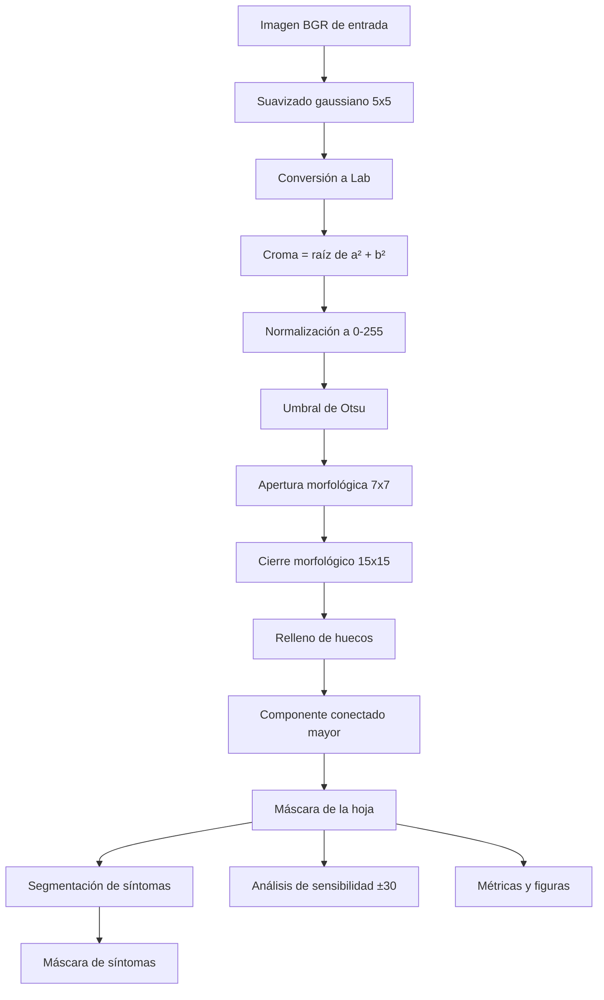
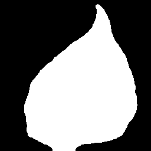
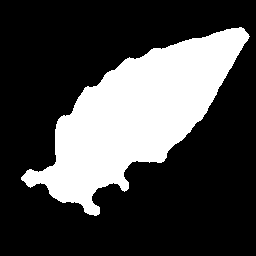
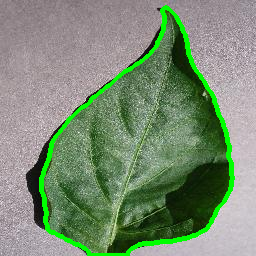
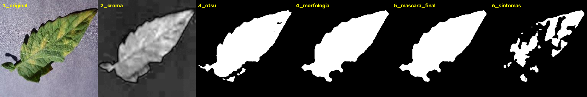
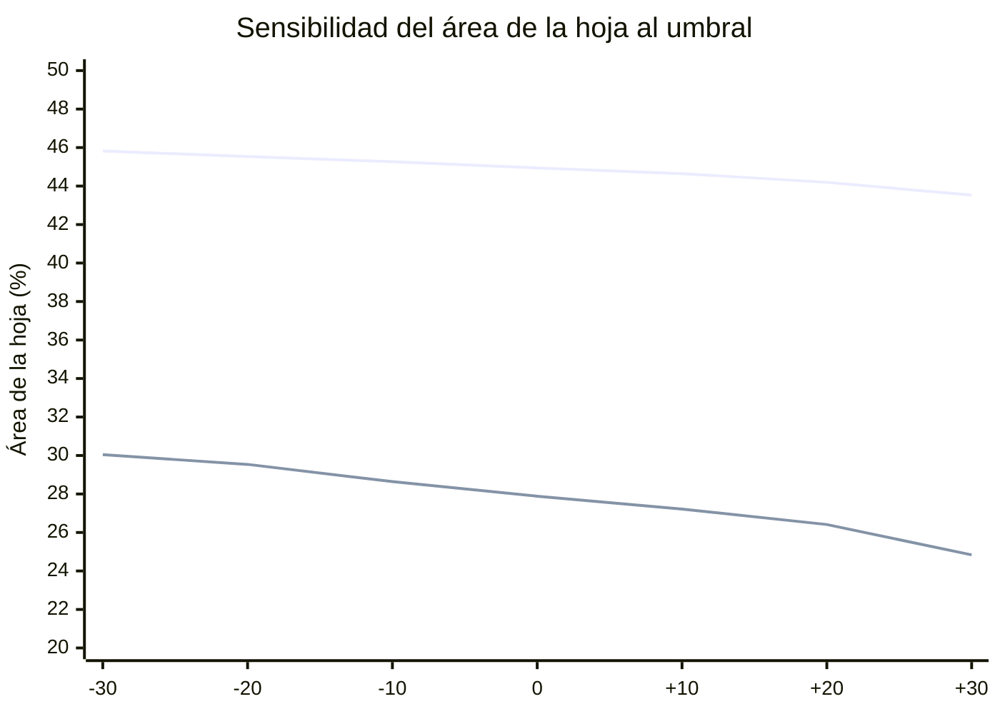

# Segmentación de hojas de tomate con procesamiento digital de imágenes clásico

> **Alcance y validez.** Este es un ejercicio de laboratorio con dos imágenes (PVC1 y PVC2), ejecutado en un entorno controlado. Los resultados ilustran el método; **no tienen validez para un diagnóstico agronómico real** ni permiten estimar el comportamiento del pipeline sobre un conjunto amplio de hojas, cámaras o condiciones de iluminación.

## Resumen

Se diseñó un pipeline clásico de procesamiento digital de imágenes (PDI) para separar la hoja de tomate del fondo y, dentro de la hoja, estimar zonas con síntomas de amarillamiento y necrosis. El resultado de cada imagen es una **máscara binaria** (blanco = hoja, negro = fondo). Se comparó el espacio de color HSV (saturación) con el croma en Lab, y se eligió el croma porque la saturación no segmentó correctamente la hoja PVC1.

## Objetivo

1. Obtener una imagen binaria de cada hoja mediante un pipeline reproducible.
2. Documentar cada etapa del preprocesamiento y justificar las decisiones de diseño.
3. Medir la sensibilidad del área segmentada frente al umbral.

## Datos

| Imagen | Dimensiones | Descripción visual | Condición |
|---|---|---|---|
| PVC1.JPG | 256 × 256 px | Hoja verde sana sobre fondo gris | Sana |
| PVC2.JPG | 256 × 256 px | Hoja con amarillamiento y bordes oscuros sobre fondo gris | Con síntomas |

Ambas imágenes se procesan sin recorte previo. No se dispone de máscaras de referencia hechas a mano, por lo que IoU y Dice no se calculan en este reporte (ver [Métricas](#métricas)).

## Pipeline



Cada etapa tiene una función específica:

| Etapa | Función | Parámetro |
|---|---|---|
| Suavizado gaussiano | Reduce el ruido del sensor | Núcleo 5 × 5 |
| Conversión a Lab y croma | Separa el color del brillo y mide qué tan alejado está del gris | Canales a* y b* |
| Umbral de Otsu | Elige el corte que maximiza la separación entre hoja y fondo | Automático |
| Apertura | Elimina motas pequeñas del fondo | Elipse 7 × 7 |
| Cierre | Une huecos pequeños dentro de la hoja | Elipse 15 × 15 |
| Relleno de huecos | Completa regiones interiores que no pertenecen al fondo | Inundación desde el borde |
| Componente mayor | Conserva solo la hoja y descarta fragmentos sueltos | Conectividad 8 |

## Fundamentos

### Espacio de color Lab y croma

El espacio CIELAB separa la luminosidad $L^*$ de dos ejes cromáticos: $a^*$ (verde–rojo) y $b^*$ (azul–amarillo). El croma mide qué tan alejado está un píxel del gris neutro:

$$
C^*_{ab} = \sqrt{(a^*)^2 + (b^*)^2}
$$

El fondo gris tiene $C^*_{ab} \approx 0$, mientras que la hoja verde o amarilla tiene un croma alto. A diferencia de la saturación HSV, el croma responde poco a las sombras, porque estas cambian la luminosidad $L^*$ más que los ejes cromáticos.

### Umbral de Otsu

Otsu (1979) busca el umbral $t$ que maximiza la varianza entre clases:

$$
\sigma_B^2(t) = \omega_0(t)\,\omega_1(t)\,\left[\mu_0(t) - \mu_1(t)\right]^2
$$

donde $\omega_0$ y $\omega_1$ son las proporciones de píxeles de cada clase y $\mu_0$ y $\mu_1$ sus medias. El umbral óptimo es $t^* = \arg\max_t \sigma_B^2(t)$.

### Operaciones morfológicas

Con un elemento estructurante $B$, la erosión $\ominus$ y la dilatación $\oplus$ definen:

$$
A \circ B = (A \ominus B) \oplus B \quad \text{(apertura: elimina motas)}
$$

$$
A \bullet B = (A \oplus B) \ominus B \quad \text{(cierre: une huecos)}
$$

### Métricas de solapamiento

Si existe una máscara de referencia $R$ y la predicción es $P$:

$$
\text{IoU}(P, R) = \frac{|P \cap R|}{|P \cup R|}
$$

$$
\text{Dice}(P, R) = \frac{2\,|P \cap R|}{|P| + |R|}
$$

Ambas van de 0 a 1, donde 1 indica coincidencia perfecta. El script las calcula si se pasan máscaras con la opción `--gt`.

## Resultados

### Métricas principales

| Métrica | PVC1 (sana) | PVC2 (con síntomas) |
|---|---|---|
| Umbral de Otsu sobre croma | 91 | 110 |
| Componentes antes de selección | 1 | 1 |
| Área de la hoja (px) | 29 453 | 18 275 |
| Porcentaje de la imagen | 44.942 % | 27.885 % |
| Área de síntomas (px) | 4 560 | 8 406 |
| Síntomas sobre área de la hoja | 15.482 % | 45.997 % |

### Imágenes binarias de la hoja

| PVC1 (Hoja1) | PVC2 (Hoja2) |
|---|---|
|  |  |

### Superposición del contorno

| PVC1 | PVC2 |
|---|---|
|  |  |

### Etapas del pipeline




### Sensibilidad del área al umbral

Se desplazó el umbral de Otsu ±10, ±20 y ±30 unidades y se midió el porcentaje de la imagen clasificado como hoja.

| Desplazamiento | PVC1 (%) | PVC2 (%) |
|---|---|---|
| −30 | 45.819 | 30.042 |
| −20 | 45.537 | 29.538 |
| −10 | 45.265 | 28.642 |
| 0 (Otsu) | 44.942 | 27.885 |
| +10 | 44.646 | 27.217 |
| +20 | 44.194 | 26.413 |
| +30 | 43.527 | 24.835 |



La línea superior corresponde a PVC1 y la inferior a PVC2.

## Análisis

**PVC1 es estable.** Con un desplazamiento de ±30 unidades, el área cambia menos de 2 puntos porcentuales. La hoja sana tiene un contraste de croma marcado frente al fondo, así que el umbral no es crítico.

**PVC2 es más sensible.** Su área varía casi 5 puntos porcentuales en el mismo rango. La zona amarilla tiene un croma cercano al del borde oscuro, por lo que el umbral queda más cerca de la frontera entre clases.

**Comparación con la saturación HSV.** Antes de elegir el croma se evaluó la saturación. Los resultados fueron:

| Método | PVC1 área (px) | PVC1 (%) | PVC2 área (px) | PVC2 (%) |
|---|---|---|---|---|
| Saturación HSV + Otsu | 13 702 | 20.908 | 20 510 | 31.296 |
| Croma Lab + Otsu | 29 453 | 44.942 | 18 275 | 27.885 |

Con saturación, PVC1 quedó fragmentada: el lado izquierdo de la hoja, de menor saturación, quedó fuera de la máscara. Con croma, la hoja queda completa. En PVC2 la diferencia es de 3.4 puntos porcentuales; la máscara de croma sigue mejor el contorno visible.

**Falso positivo en la sombra.** En PVC1, la segmentación de síntomas marca como necrosis una zona oscura de la parte inferior derecha. Esa zona es una sombra de la propia hoja, no daño. El criterio de valor bajo ($V < 60$) no distingue entre sombra y necrosis. Este punto se reporta como limitación.

## Limitaciones

- Solo dos imágenes, sin repeticiones ni variación de iluminación.
- Sin máscaras de referencia manuales, no se calcularon IoU ni Dice.
- Los rangos de síntomas (amarillo: matiz 15–40 con saturación mayor a 60; necrosis: valor menor a 60) son orientativos y no están calibrados con datos etiquetados.
- Las sombras pueden clasificarse como necrosis.
- El umbral de Otsu asume dos clases bien separadas; la hoja PVC2 se acerca a esa suposición pero no la cumple del todo.

## Ejecución

Requisitos: Python 3.9 o superior.

```bash
cd 05-segmentacion-hojas
pip install -r requirements.txt
python segmentar_hojas.py --imagenes PVC1.JPG PVC2.JPG --salida resultados_segmentacion
```

Para calcular IoU y Dice con máscaras de referencia (mismo orden que las imágenes):

```bash
python segmentar_hojas.py --imagenes PVC1.JPG PVC2.JPG --gt ref_PVC1.png ref_PVC2.png --salida resultados_segmentacion
```

### Archivos generados

| Archivo | Contenido |
|---|---|
| `<imagen>_mascara_hoja.png` | Máscara binaria de la hoja |
| `<imagen>_mascara_sintomas.png` | Máscara de síntomas dentro de la hoja |
| `<imagen>_superposicion.png` | Contorno de la hoja sobre la imagen original |
| `<imagen>_etapas.png` | Montaje con todas las etapas del pipeline |
| `<imagen>_metricas.json` | Área, porcentajes, umbral y sensibilidad |

## Estructura del repositorio

```text
05-segmentacion-hojas/
├── segmentar_hojas.py
├── requirements.txt
├── README.md
├── PVC1.JPG
├── PVC2.JPG
└── resultados_segmentacion/
    ├── PVC1_mascara_hoja.png
    ├── PVC1_mascara_sintomas.png
    ├── PVC1_superposicion.png
    ├── PVC1_etapas.png
    ├── PVC1_metricas.json
    ├── PVC2_mascara_hoja.png
    ├── PVC2_mascara_sintomas.png
    ├── PVC2_superposicion.png
    ├── PVC2_etapas.png
    └── PVC2_metricas.json
```

## Glosario

| Término | Definición |
|---|---|
| Binaria (imagen) | Imagen con solo dos valores: 0 (negro, fondo) y 255 (blanco, hoja). |
| Croma | Distancia de un color al gris neutro en el espacio Lab. |
| Espacio Lab | Espacio de color con luminosidad $L^*$ y ejes cromáticos $a^*$ y $b^*$. |
| Máscara | Imagen binaria que marca qué píxeles pertenecen a un objeto. |
| Morfología matemática | Operaciones sobre formas binarias: erosión, dilatación, apertura y cierre. |
| Otsu | Método que elige un umbral automático maximizando la separación entre dos clases. |
| Componente conectado | Conjunto de píxeles blancos conectados entre sí. |
| Dice | Medida de solapamiento entre dos máscaras, entre 0 y 1. |
| IoU | Intersección sobre unión; medida de solapamiento entre 0 y 1. |

## Referencias

- Otsu, N. (1979). A threshold selection method from gray-level histograms. *IEEE Transactions on Systems, Man, and Cybernetics*, 9(1), 62–66.
- Gonzalez, R. C., & Woods, R. E. (2018). *Digital Image Processing* (4.ª ed.). Pearson.
- Jaccard, P. (1912). The distribution of the flora in the alpine zone. *New Phytologist*, 11(2), 37–50.
- Dice, L. R. (1945). Measures of the amount of ecologic association between species. *Ecology*, 26(3), 297–302.
- CIE (1976). *Colorimetry*, publicación CIE 15, espacio CIELAB.
- Documentación de OpenCV: https://docs.opencv.org

## Declaración de uso de IA

Se empleó ayuda de inteligencia artificial (Claude) para el diseño del pipeline, la redacción del código y la documentación. Los resultados fueron verificados visualmente por la autora.
