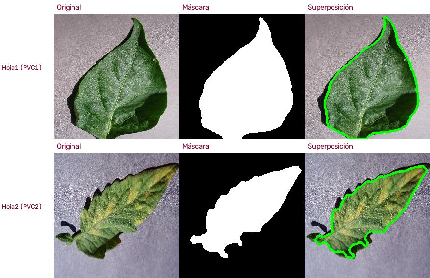
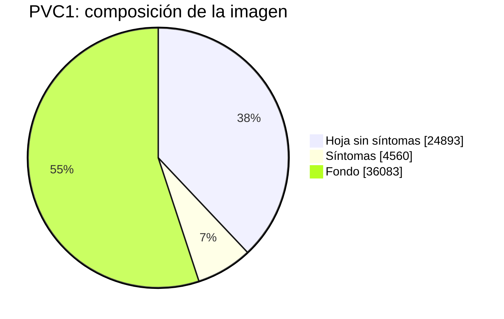
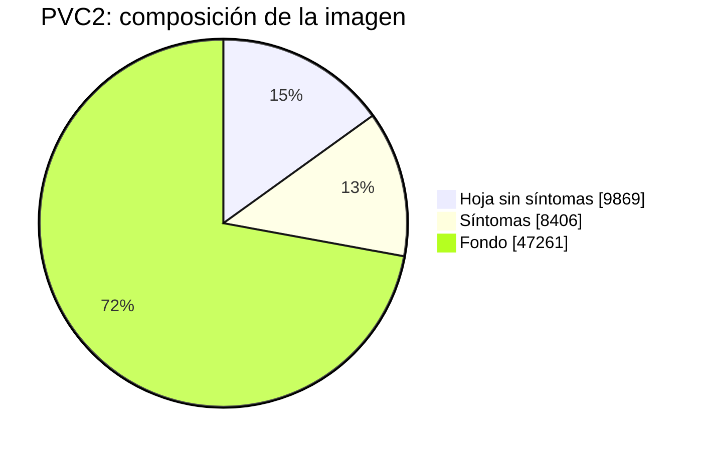
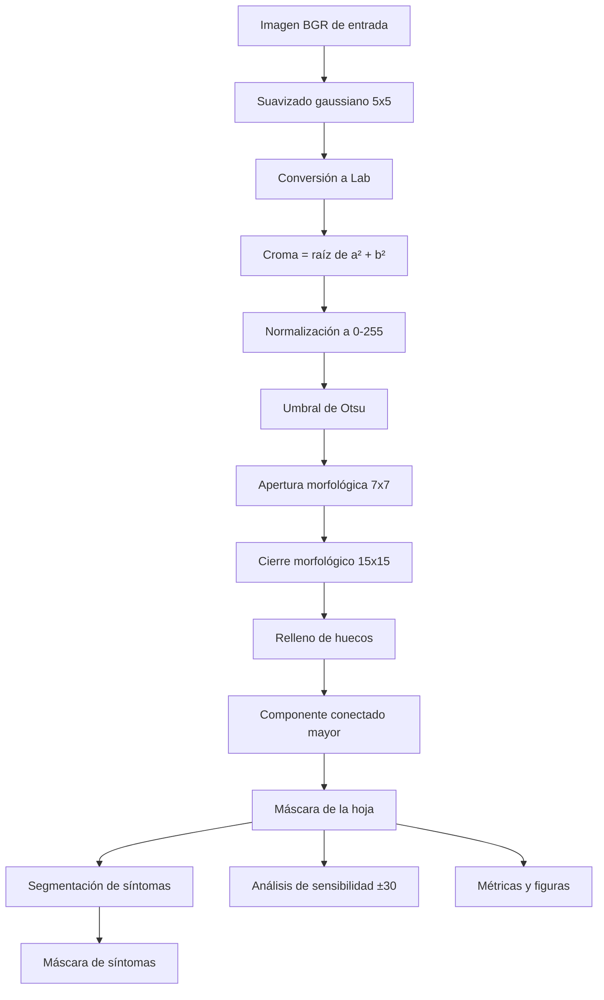
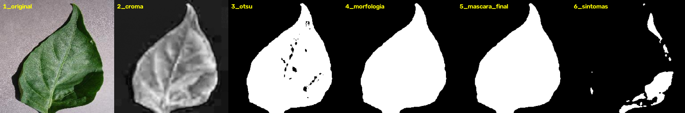
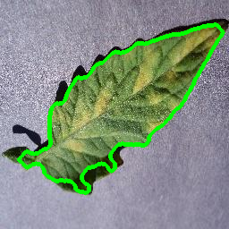
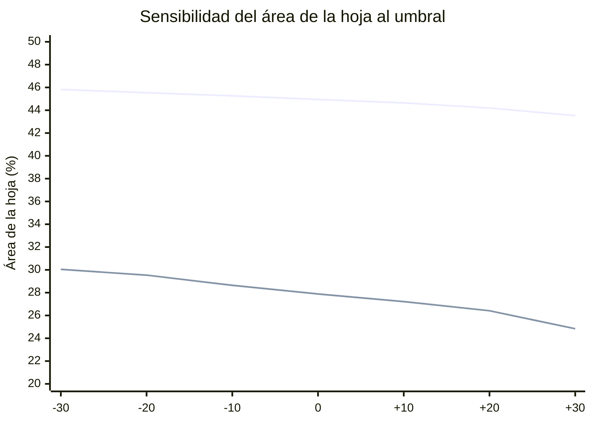

# Segmentación de hojas de tomate con procesamiento digital de imágenes clásico

  

**De una fotografía de hoja a una máscara binaria, sin aprendizaje automático.** Un pipeline clásico de PDI separa la hoja del fondo, delimita el amarillamiento y cuantifica la sensibilidad del resultado al umbral.



> **Alcance y validez.** Ejercicio de laboratorio con dos imágenes (PVC1 y PVC2), ejecutado en un entorno controlado. Los resultados ilustran el método y **no tienen validez para un diagnóstico agronómico real**.

## Tabla de contenidos

- [Intención y alcance](#intención-y-alcance)
- [Resultados de un vistazo](#resultados-de-un-vistazo)
- [Mapa de alcance](#mapa-de-alcance)
- [Concepto y origen](#concepto-y-origen)
- [Importancia y aplicaciones industriales](#importancia-y-aplicaciones-industriales)
- [Datos](#datos)
- [Notación](#notación)
- [Pipeline](#pipeline)
- [Descripción paso a paso](#descripción-paso-a-paso)
- [Fundamentos](#fundamentos)
- [Resultados](#resultados)
- [Análisis](#análisis)
- [Decisiones de diseño](#decisiones-de-diseño)
- [Observaciones metodológicas](#observaciones-metodológicas)
- [Insights](#insights)
- [Limitaciones](#limitaciones)
- [Ejecución](#ejecución)
- [Estructura del repositorio](#estructura-del-repositorio)
- [Glosario](#glosario)
- [Referencias](#referencias)
- [Declaración de uso de IA](#declaración-de-uso-de-ia)

## Intención y alcance

**Pregunta que responde el proyecto:** ¿se puede aislar una hoja de tomate de su fondo y cuantificar el amarillamiento con procesamiento clásico, sin entrenar un modelo?

**Qué sí hace:**
- Obtiene una máscara binaria de la hoja con un pipeline reproducible.
- Explica cada decisión con evidencia visual y numérica.
- Mide cuánto depende el área segmentada del umbral elegido.

**Qué no hace:**
- No valida la segmentación con máscaras de referencia (IoU y Dice quedan pendientes).
- No calibra los rangos de síntomas con datos etiquetados.
- No generaliza a otras cámaras, iluminaciones ni variedades.

## Resultados de un vistazo

| Métrica | PVC1 (sana) | PVC2 (con síntomas) |
|---|---|---|
| Área de la hoja | 29 453 px (44.942 % de la imagen) | 18 275 px (27.885 % de la imagen) |
| Área de síntomas | 4 560 px (15.482 % de la hoja) | 8 406 px (45.997 % de la hoja) |
| Sensibilidad del área (±30 unidades) | 43.527 % a 45.819 % | 24.835 % a 30.042 % |
| Umbral de Otsu sobre croma | 91 | 110 |

**Composición de cada imagen (píxeles):**





## Mapa de alcance

- [x] Segmentación de la hoja con croma en Lab y umbral de Otsu
- [x] Limpieza morfológica y selección del componente mayor
- [x] Segmentación exploratoria de síntomas
- [x] Análisis de sensibilidad al umbral (±30 unidades)
- [x] Comparación cualitativa entre saturación HSV y croma Lab
- [x] Reporte visual con figuras y métricas en JSON
- [ ] IoU y Dice con máscaras de referencia hechas a mano
- [ ] Ampliación a más imágenes con distintas condiciones de iluminación
- [ ] Calibración de los rangos de síntomas con datos etiquetados
- [ ] Tratamiento explícito de sombras para evitar falsos positivos de necrosis

## Concepto y origen

La **segmentación semántica clásica** consiste en asignar a cada píxel una etiqueta (objeto o fondo) usando solo sus propiedades de color, brillo o textura, sin aprendizaje automático. Su base teórica se apoya en tres líneas de trabajo:

- **Umbralado (*thresholding*).** Otsu (1979) propuso elegir el umbral que maximiza la varianza entre clases del histograma. Sigue siendo el método de umbral global más citado.
- **Espacios de color perceptuales.** La CIE definió el espacio CIELAB (1976) para que distancias numéricas se parezcan a diferencias percibidas por el ojo humano.
- **Morfología matemática.** Matheron (1975) y Serra (1982) formalizaron la erosión, la dilatación, la apertura y el cierre como operaciones sobre conjuntos, base de las operaciones de limpieza de máscaras.

**Metáfora.** Imagina clasificar a los invitados de una fiesta en dos salas sin preguntarles nada: solo miras su camiseta. Otsu decide dónde poner la línea divisoria; la morfología limpia a quienes quedaron en la sala equivocada; el componente mayor se queda con el grupo más grande que está unido.

## Importancia y aplicaciones industriales

Medir un objeto requiere primero aislarlo. Una máscara binaria confiable es el insumo de casi cualquier medición posterior: área, forma, color medio o proporción de daño.

| Área | Uso de la máscara | Ejemplo |
|---|---|---|
| Fenotipado agrícola | Medir área foliar y proporción dañada para comparar variedades | Evaluar resistencia de tomate a una enfermedad |
| Control de calidad en alimentos | Clasificar frutas y verduras por área afectada | Separar papas con defectos superficiales en una línea de empaque |
| Inspección en manufactura | Separar la pieza del fondo antes de medirla o buscar defectos | Verificar dimensiones de piezas metálicas en banda |
| Monitoreo ambiental | Estimar cobertura vegetal en imágenes de drones | Seguir la pérdida de cobertura en una zona reforestada |

**Por qué un método clásico sigue siendo útil.** Es transparente, cada etapa se puede verificar con una imagen, no necesita datos etiquetados y corre en una laptop sin GPU. Su costo es la sensibilidad a las condiciones de captura, que este reporte documenta.

## Datos

| Imagen | Dimensiones | Descripción visual | Condición |
|---|---|---|---|
| PVC1.JPG | 256 × 256 px | Hoja verde sana sobre fondo gris | Sana |
| PVC2.JPG | 256 × 256 px | Hoja con amarillamiento y bordes oscuros sobre fondo gris | Con síntomas |

No se dispone de máscaras de referencia hechas a mano, por lo que IoU y Dice no se calculan en este reporte.

## Notación

| Símbolo | Significado |
|---|---|
| `I(x, y)` | Imagen de entrada en el píxel (x, y) |
| `L*`, `a*`, `b*` | Luminosidad y ejes cromáticos en CIELAB |
| `C*ab` | Croma: distancia al gris neutro en el plano a*b* |
| `t*` | Umbral óptimo de Otsu |
| `σB²(t)` | Varianza entre clases para el umbral t |
| `B` | Elemento estructurante de la morfología |
| `P`, `R` | Máscara predicha y máscara de referencia |
| `IoU`, `Dice` | Índices de solapamiento entre P y R |

## Pipeline



## Descripción paso a paso

1. **Lectura.** Se carga la imagen en formato BGR de 256 × 256 píxeles.
2. **Suavizado.** Un filtro gaussiano 5 × 5 reduce el ruido del sensor sin desplazar los bordes.
3. **Espacio de color.** La imagen se convierte a CIELAB. Se calcula el croma `C*ab = √(a*² + b*²)` y se normaliza a 0–255.
4. **Umbral.** Otsu elige `t*` sobre el croma y produce una imagen binaria.
5. **Apertura.** Una elipse 7 × 7 elimina motas pequeñas.
6. **Cierre.** Una elipse 15 × 15 une huecos pequeños dentro de la hoja.
7. **Relleno.** Se inunda el fondo desde el borde; los huecos cerrados se rellenan.
8. **Selección.** Se conserva el componente conectado de mayor área: la hoja.
9. **Síntomas.** Dentro de la hoja se marca amarillamiento (matiz 15–40 con saturación mayor a 60) y zonas oscuras (valor menor a 60).
10. **Sensibilidad.** Se repite la segmentación con el umbral desplazado ±10, ±20 y ±30 unidades.
11. **Salidas.** Se guardan máscaras, superposición, montaje de etapas y métricas en JSON.

Montaje de etapas por imagen:




## Fundamentos

### Espacio de color Lab y croma

El espacio CIELAB separa la luminosidad `L*` de dos ejes cromáticos: `a*` (verde–rojo) y `b*` (azul–amarillo). El croma mide qué tan alejado está un píxel del gris neutro:

```text
C*ab = √(a*² + b*²)
```

El fondo gris tiene `C*ab` cercano a cero, mientras que la hoja verde o amarilla tiene un croma alto. A diferencia de la saturación HSV, el croma responde poco a las sombras, porque estas cambian sobre todo la luminosidad `L*`.

### Umbral de Otsu

Otsu (1979) busca el umbral `t` que maximiza la varianza entre clases:

```text
σB²(t) = ω0(t) · ω1(t) · [μ0(t) − μ1(t)]²
```

donde `ω0` y `ω1` son las proporciones de píxeles de cada clase, y `μ0` y `μ1` sus medias. El umbral óptimo es:

```text
t* = arg máx_t σB²(t)
```

### Operaciones morfológicas

Con un elemento estructurante `B`, la erosión `⊖` y la dilatación `⊕` definen:

```text
Apertura:  A ∘ B = (A ⊖ B) ⊕ B      (elimina motas)
Cierre:    A • B = (A ⊕ B) ⊖ B      (une huecos)
```

### Métricas de solapamiento

Si existe una máscara de referencia `R` y la predicción es `P`:

```text
IoU(P, R)  = |P ∩ R| / |P ∪ R|
Dice(P, R) = 2 · |P ∩ R| / (|P| + |R|)
```

Ambas van de 0 a 1, donde 1 indica coincidencia perfecta. El script las calcula si se pasan máscaras con la opción `--gt`.

## Resultados

### Máscaras binarias de la hoja

| PVC1 (Hoja1) | PVC2 (Hoja2) |
|---|---|
|  |  |

### Superposición del contorno

| PVC1 | PVC2 |
|---|---|
|  |  |

### Sensibilidad del área al umbral

Se desplazó el umbral de Otsu ±10, ±20 y ±30 unidades y se midió el porcentaje de la imagen clasificado como hoja.

| Desplazamiento | PVC1 (%) | PVC2 (%) |
|---|---|---|
| −30 | 45.819 | 30.042 |
| −20 | 45.537 | 29.538 |
| −10 | 45.265 | 28.642 |
| 0 (Otsu) | 44.942 | 27.885 |
| +10 | 44.646 | 27.217 |
| +20 | 44.194 | 26.413 |
| +30 | 43.527 | 24.835 |



La línea superior corresponde a PVC1 y la inferior a PVC2.

## Análisis

**PVC1 es estable.** Con un desplazamiento de ±30 unidades, el área cambia unos 2.3 puntos porcentuales. La hoja sana tiene un contraste de croma marcado frente al fondo, así que el umbral no es crítico.

**PVC2 es más sensible.** Su área varía unos 5 puntos porcentuales en el mismo rango. La zona amarilla tiene un croma cercano al del borde oscuro, por lo que el umbral queda más cerca de la frontera entre clases.

**Falso positivo en la sombra.** En PVC1, la segmentación de síntomas marca como necrosis una zona oscura de la parte inferior derecha. Esa zona es una sombra de la propia hoja, no daño. El criterio de valor bajo no distingue entre sombra y necrosis.

## Decisiones de diseño

| Decisión | Alternativa descartada | Motivo | Evidencia |
|---|---|---|---|
| Canal croma en Lab | Saturación HSV | La sombra afecta sobre todo la luminosidad | PVC1: 29 453 px con croma frente a 13 702 px con saturación |
| Umbral de Otsu automático | Umbral fijo | Evita ajustar un valor por imagen | Umbrales 91 y 110 en dos condiciones distintas |
| Elementos 7 × 7 y 15 × 15 | Elementos mayores | Limpian sin borrar bordes finos | Inspección visual en las figuras de etapas |
| Sensibilidad ±30 | Una sola medición | Cuantifica cuánto depende el resultado del umbral | PVC1 unos 2.3 puntos; PVC2 unos 5 puntos |

## Observaciones metodológicas

- **Canal de color.** La elección del croma sobre la saturación HSV se hizo con evidencia visual y numérica en PVC1. Elegir el canal fue la decisión más determinante del pipeline.
- **Parámetros fijos.** Los tamaños de los elementos estructurantes se eligieron para imágenes de 256 × 256 píxeles. Cambiar la resolución de la cámara obliga a reajustarlos.
- **Sin validación cuantitativa.** No hay máscaras de referencia; por eso no se reportan IoU ni Dice. La validación fue visual, y así debe citarse.
- **Sensibilidad como diagnóstico.** El análisis ±30 unidades no mejora la segmentación; sirve para saber cuánto depende el resultado del umbral.
- **Síntomas exploratorios.** Los rangos de síntomas son orientativos y no se calibraron con datos etiquetados.

## Insights

- **PVC1 es robusta al umbral.** El área cambia unos 2.3 puntos porcentuales en ±30 unidades. La hoja sana tiene un contraste de croma marcado frente al fondo.
- **PVC2 es más sensible.** El área varía unos 5 puntos porcentuales en el mismo rango. La zona amarilla y el borde oscuro tienen croma cercano, así que el umbral cae cerca de la frontera entre clases.
- **Las sombras confunden la necrosis.** En PVC1, la zona oscura de la parte inferior derecha es una sombra, no daño. Se requiere un tratamiento explícito de sombras.
- **La saturación subestima hojas con zonas de baja saturación.** Con HSV, la mitad izquierda de PVC1 quedó fuera de la máscara.
- **El porcentaje de síntomas es una magnitud aproximada.** Un 46 % en PVC2 indica amarillamiento importante, pero la cifra exacta depende de rangos sin calibrar.

## Limitaciones

- Solo dos imágenes, sin repeticiones ni variación de iluminación o cámara.
- Sin máscaras de referencia manuales, no se calcularon IoU ni Dice.
- Los rangos de síntomas son orientativos. Las sombras pueden clasificarse como necrosis, como ocurre en PVC1.
- El umbral de Otsu asume dos clases bien separadas; PVC2 se acerca a esa condición pero no la cumple del todo.

## Ejecución

Requisitos: Python 3.9 o superior.

```bash
cd 05-segmentacion-hojas
pip install -r requirements.txt
python segmentar_hojas.py --imagenes PVC1.JPG PVC2.JPG --salida resultados_segmentacion
```

Salida esperada para PVC1 (extracto):

```json
{
  "imagen": "PVC1.JPG",
  "umbral_otsu_saturacion": 91.0,
  "area_hoja_px": 29453,
  "porcentaje_hoja": 44.942,
  "area_sintomas_px": 4560,
  "porcentaje_sintomas_sobre_hoja": 15.482
}
```

Para calcular IoU y Dice con máscaras de referencia (mismo orden que las imágenes):

```bash
python segmentar_hojas.py --imagenes PVC1.JPG PVC2.JPG --gt ref_PVC1.png ref_PVC2.png --salida resultados_segmentacion
```

### Archivos generados

| Archivo | Contenido |
|---|---|
| `<imagen>_mascara_hoja.png` | Máscara binaria de la hoja |
| `<imagen>_mascara_sintomas.png` | Máscara de síntomas dentro de la hoja |
| `<imagen>_superposicion.png` | Contorno de la hoja sobre la imagen original |
| `<imagen>_etapas.png` | Montaje con todas las etapas del pipeline |
| `<imagen>_metricas.json` | Área, porcentajes, umbral y sensibilidad |

## Estructura del repositorio

```text
05-segmentacion-hojas/
├── segmentar_hojas.py
├── requirements.txt
├── README.md
├── PVC1.JPG
├── PVC2.JPG
└── resultados_segmentacion/
    ├── resumen_visual.png
    ├── PVC1_mascara_hoja.png
    ├── PVC1_mascara_sintomas.png
    ├── PVC1_superposicion.png
    ├── PVC1_etapas.png
    ├── PVC1_metricas.json
    ├── PVC2_mascara_hoja.png
    ├── PVC2_mascara_sintomas.png
    ├── PVC2_superposicion.png
    ├── PVC2_etapas.png
    └── PVC2_metricas.json
```

## Glosario

| Término | Definición |
|---|---|
| Binaria (imagen) | Imagen con solo dos valores: 0 (negro, fondo) y 255 (blanco, hoja). |
| Croma | Distancia de un color al gris neutro en el espacio Lab. |
| Espacio Lab | Espacio de color con luminosidad `L*` y ejes cromáticos `a*` y `b*`. |
| Máscara | Imagen binaria que marca qué píxeles pertenecen a un objeto. |
| Morfología matemática | Operaciones sobre formas binarias: erosión, dilatación, apertura y cierre. |
| Otsu | Método que elige un umbral automático maximizando la separación entre dos clases. |
| Componente conectado | Conjunto de píxeles blancos conectados entre sí. |
| Dice | Medida de solapamiento entre dos máscaras, entre 0 y 1. |
| IoU | Intersección sobre unión; medida de solapamiento entre 0 y 1. |

## Referencias

- Otsu, N. (1979). A threshold selection method from gray-level histograms. *IEEE Transactions on Systems, Man, and Cybernetics*, 9(1), 62–66.
- Gonzalez, R. C., & Woods, R. E. (2018). *Digital Image Processing* (4.ª ed.). Pearson.
- Matheron, G. (1975). *Random Sets and Integral Geometry*. Wiley.
- Serra, J. (1982). *Image Analysis and Mathematical Morphology*. Academic Press.
- Jaccard, P. (1912). The distribution of the flora in the alpine zone. *New Phytologist*, 11(2), 37–50.
- Dice, L. R. (1945). Measures of the amount of ecologic association between species. *Ecology*, 26(3), 297–302.
- CIE (1976). *Colorimetry*, publicación CIE 15, espacio CIELAB.
- Documentación de OpenCV: https://docs.opencv.org

## Declaración de uso de IA

Se empleó ayuda de inteligencia artificial (Claude) para el diseño del pipeline, la redacción del código y la documentación. Los resultados fueron verificados visualmente por la autora.
