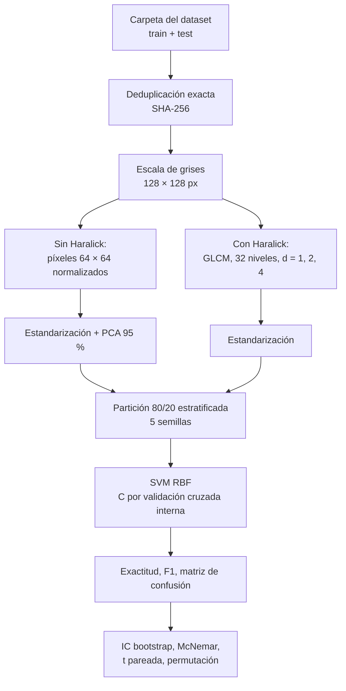

# Práctica 6. Reconocimiento de suelos con y sin descriptores de Haralick


> ¿Basta la textura de la superficie para distinguir cuatro tipos de suelo, o los propios píxeles ya contienen esa información?

**Figura resumen:** pendiente de generación. Se agregará en `salidas/figuras/` tras la ejecución.

## Tabla de contenidos

- [Intención y alcance](#intención-y-alcance)
- [Resultados de un vistazo](#resultados-de-un-vistazo)
- [Mapa de alcance](#mapa-de-alcance)
- [Concepto y origen](#concepto-y-origen)
- [Notación](#notación)
- [Pipeline](#pipeline)
- [Fundamentos](#fundamentos)
- [Protocolo de evaluación](#protocolo-de-evaluación)
- [Resultados](#resultados)
- [Decisiones de diseño](#decisiones-de-diseño)
- [Observaciones metodológicas](#observaciones-metodológicas)
- [Limitaciones](#limitaciones)
- [Ejecución](#ejecución)
- [Estructura del repositorio](#estructura-del-repositorio)
- [Glosario](#glosario)
- [Referencias](#referencias)
- [Declaración de uso de IA](#declaración-de-uso-de-ia)

## Intención y alcance

**Pregunta que responde:** con un mismo clasificador (SVM con núcleo RBF) y el mismo protocolo, ¿la representación por descriptores de textura de Haralick reconoce mejor el tipo de suelo que la representación por píxeles crudos?

**Sí hace:**

- Dos experimentos sobre el Soil DataSet (Kaggle, `naivedatamodel/soil-dataset`), con `train` y `test` unidos.
- Deduplicación exacta por SHA-256 y auditoría de casi-duplicados con hash perceptual.
- Partición estratificada 80/20 repetida con 5 semillas, y ajuste de $C$ solo con validación cruzada interna.
- Intervalos de confianza bootstrap, prueba de McNemar pareada, prueba t pareada entre semillas y prueba de permutación.

**No hace:** no compara otros clasificadores, no usa redes neuronales convolucionales, no segmenta el suelo ni evalúa color.

## Resultados de un vistazo

| Experimento | Dimensión | Exactitud media (IC 95 %) | F1 macro | Estado |
|---|---|---|---|---|
| Sin Haralick (píxeles) | 4 096 → 95 % de varianza | Pendiente | Pendiente | Sin ejecutar |
| Con Haralick (GLCM) | 78 | Pendiente | Pendiente | Sin ejecutar |

Los valores se completan con `salidas/resultados.json` después de la ejecución.

## Mapa de alcance

- [x] Protocolo de evaluación definido y documentado
- [x] Descriptores de Haralick validados contra mahotas (13 descriptores, 3 distancias)
- [x] Pipeline de extremo a extremo probado con datos sintéticos
- [ ] Ejecución sobre el Soil DataSet completo
- [ ] Análisis de resultados y figuras definitivas
- [ ] Reporte en formato DOCX

## Concepto y origen

La **textura** describe cómo varía la intensidad de los píxeles en una vecindad: un suelo arenoso y uno arcilloso pueden tener el mismo color medio y, sin embargo, una granulometría distinta. Haralick, Shanmugam y Dinstein (1973) propusieron cuantificar esa variación con la **matriz de coocurrencia de niveles de gris** (GLCM): cuenta con qué frecuencia aparece cada par de niveles separados por una distancia y una orientación dadas, y de esa matriz deriva 13 medidas escalares.

Metáfora: la GLCM es un recuento de cuántas veces un tono claro aparece junto a uno oscuro, a cierta distancia. Los descriptores resumen si ese recuento es uniforme, contrastado o ordenado.

## Notación

| Símbolo | Significado | Dimensión o dominio |
|---|---|---|
| $I$ | Imagen en escala de grises | $\{0,\dots,255\}^{H\times W}$ |
| $q$ | Imagen cuantizada a $L$ niveles | $\{0,\dots,L-1\}^{H\times W}$, $L=32$ |
| $d$ | Distancia entre píxeles de un par | $d \in \{1,2,4\}$ px |
| $\theta$ | Orientación del par | $\theta \in \{0^\circ,45^\circ,90^\circ,135^\circ\}$ |
| $P_{d,\theta}(i,j)$ | GLCM simétrica y normalizada | $L\times L$, suma 1 |
| $p_x(i)$, $p_y(j)$ | Marginales de $P$ por filas y columnas | vector de longitud $L$ |
| $p_{x+y}(k)$, $p_{x-y}(k)$ | Distribuciones de suma y diferencia | $k$ según el descriptor |
| $f_m$ | Descriptor de Haralick $m$ | $m \in \{1,\dots,13\}$ |
| $\mathbf{x}$ | Vector de características de una imagen | $\mathbb{R}^{d_f}$ |
| $\hat{y}$ | Clase predicha | $\{1,\dots,K\}$, $K=4$ |
| $a_s$ | Exactitud en la semilla $s$ | $[0,1]$ |

## Pipeline



## Fundamentos

**Matriz de coocurrencia.** Para el desplazamiento $(\Delta y, \Delta x)$ asociado a $(d,\theta)$:

$$
C_{d,\theta}(i,j) = \#\{(u,v) : q(u,v)=i,\ q(u+\Delta y,\ v+\Delta x)=j\}
$$

Se simetriza, $C + C^\top$, y se normaliza: $P_{d,\theta}(i,j) = C_{d,\theta}(i,j) / \sum_{i,j} C_{d,\theta}(i,j)$.

**Descriptores utilizados** (algunos de ellos):

$$
f_1 = \sum_{i,j} P(i,j)^2 \qquad \text{(segundo momento angular)}
$$

$$
f_2 = \sum_{i,j} (i-j)^2\, P(i,j) \qquad \text{(contraste)}
$$

$$
f_9 = -\sum_{i,j} P(i,j)\, \log_2 P(i,j) \qquad \text{(entropía)}
$$

$$
f_{13} = \sqrt{1 - e^{-2(\text{HXY}_2 - \text{HXY})}} \qquad \text{(medida de información de la correlación 2)}
$$

donde $\text{HXY}_2 = -\sum_{i,j} p_x(i)\,p_y(j)\,\log_2\big(p_x(i)\,p_y(j)\big)$ y $\text{HXY} = f_9$.

**Vector final.** Para cada distancia, se toman la media y el rango ($\max - \min$) de los 13 descriptores sobre las cuatro orientaciones. Con tres distancias, $\dim = 3 \times 13 \times 2 = 78$.

**Representación sin Haralick.** Vector de $64 \times 64 = 4\,096$ intensidades normalizadas a $[0,1]$, estandarizado y reducido por PCA a las componentes que explican el 95 % de la varianza.

## Protocolo de evaluación

**Partición.** Para cada semilla $s$, $\mathcal{D} = \mathcal{D}_{\text{ent}}^{(s)} \cup \mathcal{D}_{\text{prueba}}^{(s)}$ con 80/20 estratificado.

**Ajuste de hiperparámetros.** $C^{(s)} = \arg\max_{C \in \{0.1,\,1,\,10,\,100\}} \ \text{CV}_5\big(\mathcal{D}_{\text{ent}}^{(s)}, C\big)$. La prueba no interviene en esta selección.

**Intervalo de confianza bootstrap.** Con $B = 2\,000$ remuestreos de las muestras de prueba, $\text{IC}_{95}$ es el intervalo de percentiles 2.5 y 97.5 de las exactitudes remuestreadas.

**Intervalo sobre semillas.** Con $n = 5$ semillas y $t_{0.975,\,4}$:

$$
\text{IC}_{95} = \bar{a} \pm t_{0.975,\,4}\ \frac{s_a}{\sqrt{5}}
$$

**Prueba de McNemar.** Sean $b$ las muestras que acierta el experimento A y falla B, y $c$ las contrarias. Con $b + c \ge 25$:

$$
\chi^2 = \frac{(|b - c| - 1)^2}{b + c}, \qquad p = \Pr(\chi^2_1 \ge \chi^2)
$$

Con $b + c < 25$ se usa la prueba binomial exacta.

**Prueba t pareada entre semillas.** Sobre las diferencias $\delta_s = a^{\text{con}}_s - a^{\text{sin}}_s$.

**Prueba de permutación (control de fuga).** Se reentrena con etiquetas de entrenamiento permutadas y se evalúa sobre la prueba sin cambios. Con $B$ permutaciones:

$$
p = \frac{1 + \sum_{b=1}^{B} \mathbb{1}\big[a^{\text{nula}}_b \ge a_{\text{obs}}\big]}{1 + B}
$$

Si $p$ es grande, la exactitud observada no supera lo que se obtiene por azar y no hay evidencia de aprendizaje real.

## Resultados

*Sección pendiente de ejecución.* Se completará con `salidas/resultados.json` y las figuras de `salidas/figuras/`. Cada cifra incluirá su intervalo de confianza y la prueba estadística correspondiente.

| Indicador | Sin Haralick | Con Haralick | Prueba |
|---|---|---|---|
| Exactitud media (IC 95 %) | Pendiente | Pendiente | IC t sobre semillas |
| Diferencia media con − sin (IC 95 %) | — | Pendiente | t pareada |
| McNemar (valor $p$ medio por semilla) | — | — | Pendiente |
| Permutación (valor $p$) | Pendiente | Pendiente | Permutación |
| Costo de extracción (ms por imagen) | Pendiente | Pendiente | Medición directa |

## Decisiones de diseño

| Decisión | Alternativa descartada | Motivo | Evidencia |
|---|---|---|---|
| Entropías en log₂ | Logaritmo natural | Convención de la implementación de referencia (mahotas) | Prueba de igualdad con mahotas, `tests/test_haralick.py` |
| Varianza de la diferencia sobre los valores de $p_{x-y}$ | Varianza ponderada por $k$ | Coincide con la referencia | Mismo test |
| Distribución de diferencia plegada en $\lvert i-j \rvert$ | Distribución con signo | Definición original de Haralick | Mismo test |
| Unir `train` y `test` y re-particionar | Partición original | Usa todas las imágenes y evita sesgos de la partición original | Sección de control de duplicados |
| PCA con 95 % de varianza | Número fijo de componentes | Se adapta al tamaño de muestra de cada pliegue | Prueba con muestras pequeñas |
| Un solo clasificador (SVM RBF) | Varios clasificadores | Alcance del encargo: solo se compara la representación | Protocolo común a ambos experimentos |

## Observaciones metodológicas

- Los 13 descriptores se validaron contra mahotas en tres distancias. Las orientaciones de mahotas no siguen el mismo orden, por lo que la comparación es sobre los valores ordenados; el vector final usa media y rango, que no dependen del orden.
- Los duplicados exactos se eliminan antes de particionar. Los casi-duplicados (distancia de Hamming $\le 4$ sobre aHash de 64 bits) se cuentan entre entrenamiento y prueba como control de fuga.
- La escala de grises y el tamaño de 128 px son comunes a ambos experimentos, para que la única diferencia sea la representación.

## Limitaciones

- Un solo clasificador y un solo conjunto de hiperparámetros por experimento.
- La exactitud depende de la distribución de clases del dataset; con clases desbalanceadas conviene revisar el F1 por clase.
- El cómputo de Haralick por imagen es mayor que el de los píxeles; la ventaja en exactitud debe leerse junto con el costo.
- Las conclusiones aplican a este dataset y a estas condiciones de iluminación y resolución.

## Ejecución

**Requisitos:** Python 3.9 o superior. Credenciales de Kaggle si se descarga con `kagglehub`.

```bash
cd 06-reconocimiento-suelos
python -m venv .venv
source .venv/bin/activate          # Windows PowerShell: .venv\Scripts\Activate.ps1
pip install -r requirements.txt
python -m pytest -q tests          # valida Haralick contra mahotas
python -m src.main --datos RUTA_DEL_DATASET --salida salidas
```

**Salida esperada:** una línea por experimento y semilla con su exactitud e IC 95 %, seguida de `Listo: N imágenes; resultados en salidas`. La ejecución completa tarda unos minutos.

**Salidas** (en `salidas/`):

- `resultados.json`: métricas, comparaciones y pruebas estadísticas.
- `f1_por_clase.csv`: F1 por clase, media y desviación sobre semillas.
- `figuras/`: muestra por clase, matrices de confusión, distribuciones nulas y exactitud con IC.

El notebook `reconocimiento_suelos.ipynb` ejecuta los mismos pasos y muestra los resultados en línea.

## Estructura del repositorio

```text
06-reconocimiento-suelos/
├── README.md
├── requirements.txt
├── .gitignore
├── src/
│   ├── __init__.py
│   ├── datos.py           # catálogo, deduplicación, carga y aHash
│   ├── haralick.py        # GLCM y 13 descriptores de Haralick (NumPy)
│   ├── caracteristicas.py # extractores: píxeles y Haralick
│   ├── evaluacion.py      # SVM, búsqueda de C, IC, McNemar, permutación
│   ├── experimento.py     # orquestación y figuras
│   └── main.py            # punto de entrada
└── tests/
    └── test_haralick.py   # validación contra mahotas
```

## Glosario

- **GLCM:** matriz de coocurrencia de niveles de gris; cuenta pares de píxeles a una distancia y orientación dadas.
- **Descriptor de Haralick:** medida escalar derivada de la GLCM, como contraste o entropía.
- **Cuantización:** reducción del número de niveles de gris; aquí de 256 a 32.
- **PCA:** análisis de componentes principales; proyecta los datos a direcciones de máxima varianza.
- **SVM RBF:** máquina de vectores de soporte con núcleo de base radial.
- **Validación cruzada estratificada:** divide los datos en pliegues conservando la proporción de clases.
- **Bootstrap:** estimación de la incertidumbre remuestreando con reemplazo.
- **McNemar:** prueba pareada para comparar la exactitud de dos clasificadores sobre las mismas muestras.
- **Prueba de permutación:** compara el resultado observado con el obtenido al romper la relación entre datos y etiquetas.
- **aHash:** hash perceptual de 64 bits que identifica imágenes casi idénticas.

## Referencias

1. Haralick, R. M., Shanmugam, K., y Dinstein, I. (1973). Textural features for image classification. *IEEE Transactions on Systems, Man, and Cybernetics*, SMC-3(6), 610–621.
2. Coelho, L. P. (2013). Mahotas: Open source software for scriptable computer vision. *Journal of Open Research Software*, 1(1).
3. McNemar, Q. (1947). Note on the sampling error of the difference between correlated proportions or percentages. *Psychometrika*, 12(2), 153–157.
4. Pedregosa, F. et al. (2011). Scikit-learn: Machine learning in Python. *Journal of Machine Learning Research*, 12, 2825–2830.
5. Dataset: naivedatamodel, *Soil DataSet*, Kaggle (`naivedatamodel/soil-dataset`). Consultar la licencia en la página del dataset.

## Declaración de uso de IA

Se usó asistencia de inteligencia artificial (Claude) para el diseño del código, la redacción de la documentación y la revisión de las pruebas. Los resultados se verifican ejecutando el código sobre los datos.
